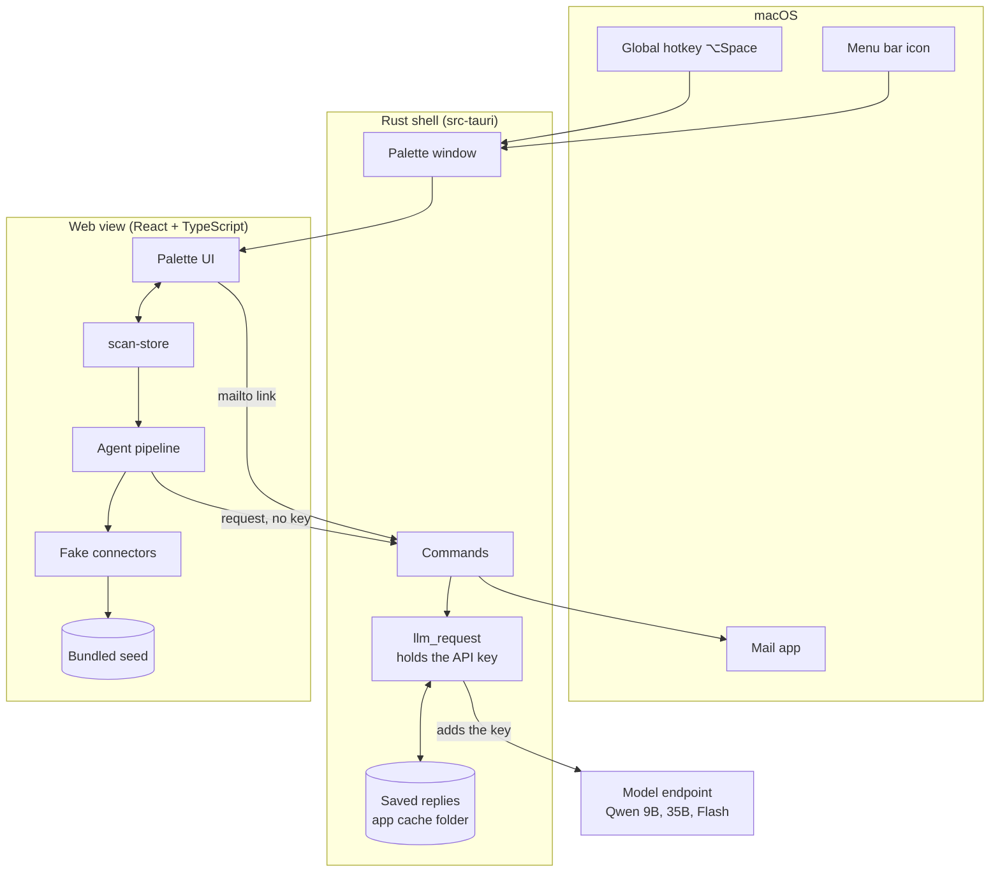
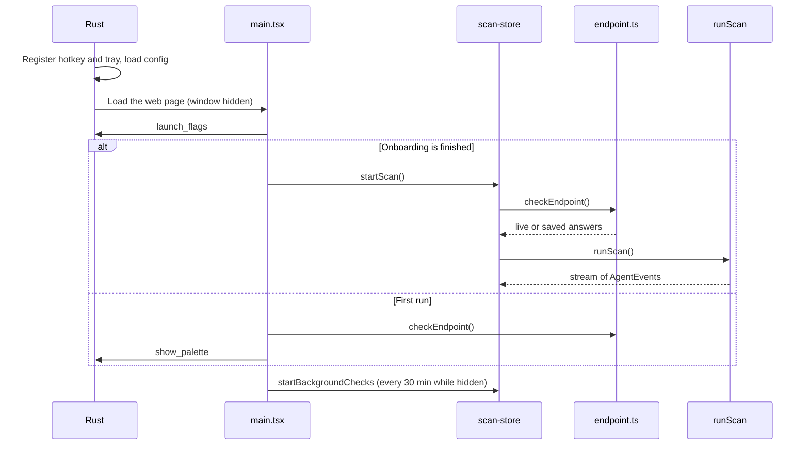
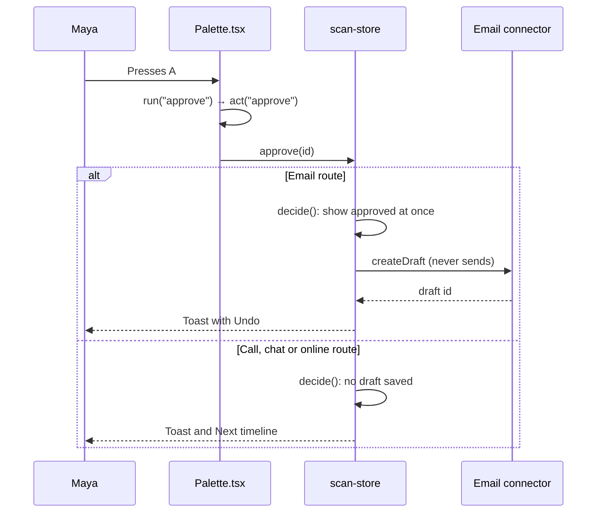
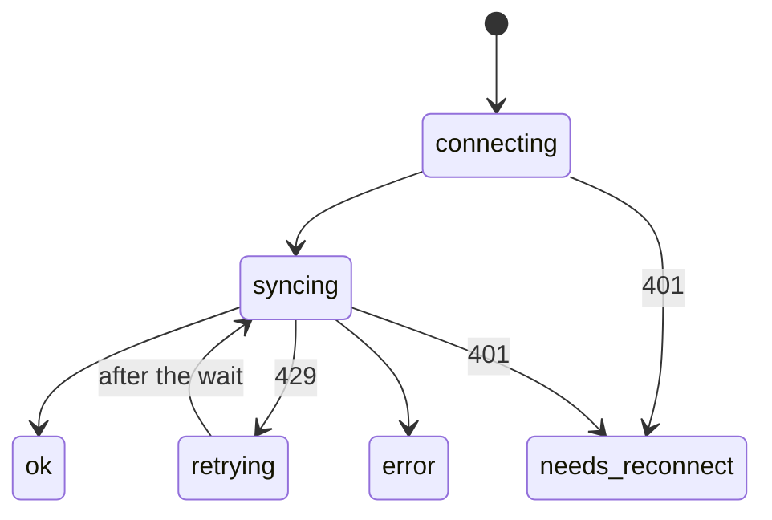
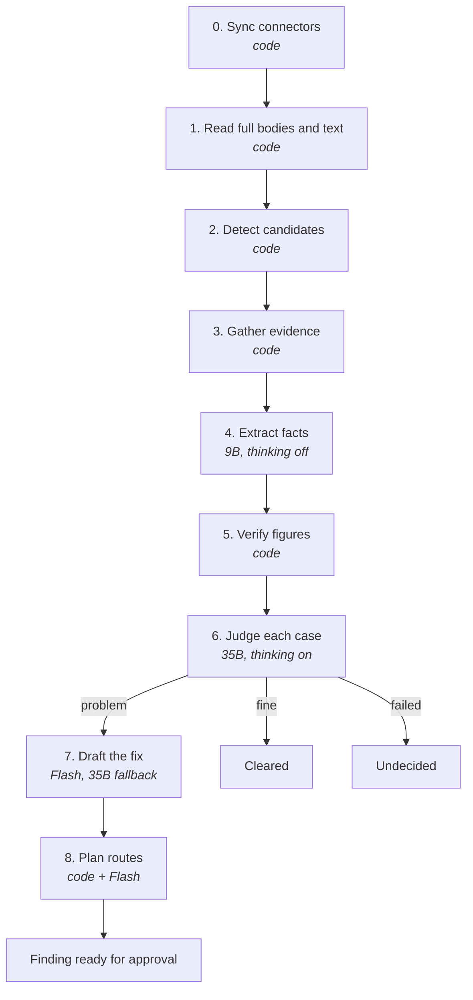
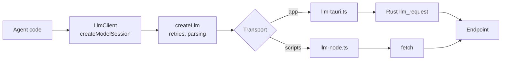
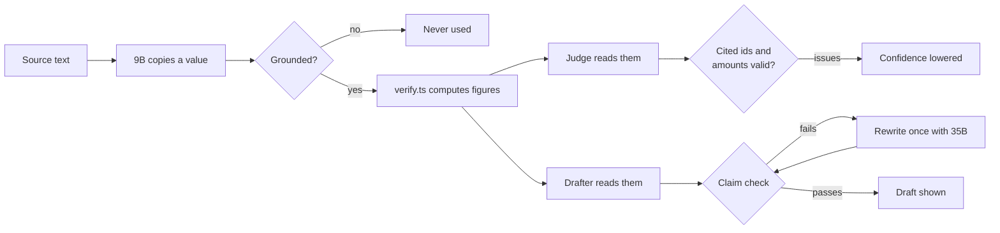
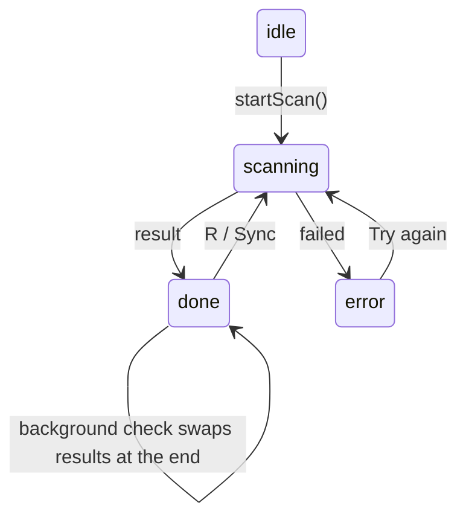
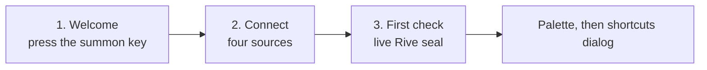

# Seal architecture guide

A complete handover for someone new to the codebase. After a day or two with this guide, you should be able to run Seal, follow any feature from a key press to a model call and back, make a safe change, and know which checks prove you didn't break anything.

**How to use it:** read sections 1 to 5 first. Follow the [two-day plan](#2-your-first-two-days). Treat the rest as a reference.

## Contents

1. [What Seal is](#1-what-seal-is)
2. [Your first two days](#2-your-first-two-days)
3. [Setup, commands and dev tools](#3-setup-commands-and-dev-tools)
4. [Repo map](#4-repo-map)
5. [System overview](#5-system-overview)
6. [The Rust shell](#6-the-rust-shell)
7. [Connectors](#7-connectors)
8. [The agent pipeline](#8-the-agent-pipeline)
9. [The model layer](#9-the-model-layer)
10. [Verification and guardrails](#10-verification-and-guardrails)
11. [Features end to end](#11-features-end-to-end)
12. [State](#12-state)
13. [The interface](#13-the-interface)
14. [Design system](#14-design-system)
15. [Testing and the eval](#15-testing-and-the-eval)
16. [Recipes](#16-recipes)
17. [Rules, limits and reading order](#17-rules-limits-and-reading-order)

---

## 1. What Seal is

Seal is a macOS menu bar app for one job: **a household's monthly check for charges that are wrong or unwanted.**

It reads a family's bank statements, email, documents and calendar. It finds things like a price rise that breaks a contract, a subscription paid twice, or a bill based on a bad meter estimate. For each one, it gathers the evidence, works out the money, prepares the best way to fix it, and waits for a person to approve.

Three ideas shape the whole codebase.

**1. Summon, triage, approve.** Seal isn't a chat window. The work is done before you open it. You press ⌥Space, see what needs attention, and move through it with the keyboard.

**2. Models read, judge and write. Code counts, compares and checks.** Small models are good at reading messy text and bad at arithmetic and exact recall. So no number a person sees comes directly from a model, and every draft is checked by code before it counts as verified.

**3. Nothing happens without Maya.** The email connector has no send function. Seal can save a draft or add a reminder when she presses a key, and she finishes the step herself.

### The fictional setup

- The user is **Maya Whitlock**. Her household is entirely fictional.
- All data comes from [`seed/`](../../seed/). See the [seed data guide](../seed/seed-data.md).
- The app's clock is fixed at **Thursday 19 November 2026, 9:30 am Melbourne**.
- Model calls go to an OpenAI-compatible endpoint running Qwen models, standing in for models that would run on the user's own device. In this build, the household data the agent reads is sent to that endpoint.

### Glossary

| Term | Meaning | Where |
| --- | --- | --- |
| **Connector** | A fake service for bank, email, documents or calendar | `src/connectors/` |
| **Seed** | The fictional household's data | `seed/` |
| **Corpus** | Everything read in one check, held in memory | `src/agent/corpus.ts` |
| **Series** | A recurring charge found in the bank history | `src/agent/series.ts` |
| **Signal** | One suspicious thing noticed by a code rule | `src/agent/detectors.ts` |
| **Candidate** | Signals about one business, grouped into a case to examine | `src/agent/detectors.ts` |
| **Evidence** | Transactions, emails, documents and events linked to a case | `src/agent/retrieval.ts` |
| **Grounded** | A value that code confirmed appears in its source text | `src/agent/grounding.ts` |
| **Figure** | A number or date worked out by code, with its sources | `src/agent/verify.ts` |
| **Verdict** | The judge model's decision on a case | `src/agent/judge.ts` |
| **Finding** | A confirmed problem shown to Maya | `src/agent/pipeline.ts` |
| **Cleared** | A case checked and left alone, like the decoys | `src/agent/pipeline.ts` |
| **Undecided** | A case that couldn't be judged | `src/agent/pipeline.ts` |
| **Draft** | The email that would fix a finding | `src/agent/draft.ts` |
| **Claim check** | Code that rejects any fact in a draft not found in the evidence | `src/agent/draft.ts` |
| **Route / fix plan** | The ways to fix a finding: email, call, chat or online | `src/agent/routes.ts` |
| **Rule** | What Seal remembers after "Not a leak" | `src/lib/rules.ts` |
| **Palette** | The app's single summoned window | `src/ui/Palette/` |
| **Trace** | The plain-words log of what the agent did | `src/ui/Palette/Trace.tsx` |
| **Saved answers / replay** | Earlier model replies reused, always labelled | `src/lib/model-session.ts` |
| **Scenario** | A failure you can switch on for testing | `src/connectors/runtime.ts` |
| **Layer** | A tooltip, menu or sheet floating over the palette | `src/ui/layers.tsx` |

---

## 2. Your first two days

### Day 1: run it and understand the flow

**Morning: get it running (about 1 hour)**

1. Follow [setup](#setup) until `pnpm tauri dev` opens the app.
2. Go through onboarding.
3. Press `?` to see every shortcut.
4. Open each of the 8 findings. Press `J`, `K`, `Enter`, `Tab`, `Esc`, `T`, and `V`.
5. Approve one, then undo it with `⌘Z`.

**Late morning: read (about 2 hours)**

1. Sections 1, 4 and 5 of this guide.
2. The [seed data guide](../seed/seed-data.md), sections 1 and 7.
3. [`src/agent/pipeline.ts`](../../src/agent/pipeline.ts). It's short and shows the whole scan in one place.

**Afternoon: trace one finding (about 3 hours)**

Follow Skylink through the code using [the worked example](#worked-example-1-skylink):

1. Find its rows in `seed/bank/joint-everyday.csv`.
2. Read `findSeries()` and `priceChanges()`.
3. Read `retrieveExact()`.
4. Read `priceChange()` in `verify.ts`.
5. Read `judgeCase()`, `draftFinding()` and `claimCheck()`.
6. Open the Skylink finding, press `T`, and match the trace to what you read.

**End of day exercise:** run the offline checks in [section 15](#15-testing-and-the-eval). Change a word in `src/copy.ts` and watch it update.

### Day 2: make a change

**Morning: the interface (about 3 hours)**

1. Read [section 12](#12-state) and [section 13](#13-the-interface).
2. Open the gallery at `http://localhost:1420/#/gallery`.
3. In `Palette.tsx`, find the `onKeyDown` handler and `run(command)`.
4. Follow `D` (Not a leak) from the key press to `dismiss()` in the store.

**Afternoon: ship something small (about 3 hours)**

Pick one:

| Task | Teaches |
| --- | --- |
| Add a gallery shot for an existing state | Fixtures and the gallery |
| Add a new filter to `src/ui/filters.ts` | List items and the filter menu |
| Add a word to the claim check's unit list, with a test | Guardrails and test scripts |
| Add a new rule case to `scripts/rules-check.ts` | Teach Seal logic |
| Add a small Settings option | Preferences and the Settings dialog |

Then run the checks in [section 15](#before-you-open-a-pr), and open a PR using the conventions in [section 17](#working-conventions).

---

## 3. Setup, commands and dev tools

### Setup

You need macOS, [Node.js](https://nodejs.org) 22.18 or newer (scripts run TypeScript directly), [pnpm](https://pnpm.io), [Rust](https://rustup.rs) and the Xcode Command Line Tools.

```bash
xcode-select --install
```

```bash
pnpm install
```

```bash
cp .env.example .env
```

Fill in `BC_BASE_URL` and `BC_API_KEY` in `.env`. `.env` is gitignored. Never commit it, print it or pass the key to the web view.

```bash
pnpm tauri dev
```

The first Rust build takes a few minutes. Seal then opens on onboarding and lives in the menu bar, with no Dock icon.

### Commands

| Command | What it does |
| --- | --- |
| `pnpm tauri dev` | Run the desktop app with hot reload |
| `pnpm dev` | Run only the web UI on port 1420, with saved answers |
| `pnpm build` | Type-check and build the web bundle |
| `cargo check` (in `src-tauri`) | Type-check the Rust side |
| `LIFE_ONBOARDING=1 pnpm tauri dev` | Start onboarding again |
| `LIFE_REPLAY=1 pnpm tauri dev` | Use saved model answers for the whole launch |
| `python3 seed/verify.py` | Check the seed data |

Script checks are in [section 15](#15-testing-and-the-eval).

### Dev tools

**The gallery** shows every component in every state, from fixed sample data, with no scan. Open `http://localhost:1420/#/gallery` in a browser, or run `__life.gallery()` in the app's console to open it in its own window.

**Demo controls** are hidden from first-time users. Press **⌘⇧D**:

| Key | Does |
| --- | --- |
| `1` | Calendar needs signing in again |
| `2` | Bank rate-limits every 4th request |
| `3` | Documents load slowly |
| `4` | The model endpoint drops after 15 calls |
| `M` | Use saved answers only |
| `O` | Start onboarding again |
| `R` | Check now |

**Console hooks** exist in dev builds on `window.__life`:

| Hook | Does |
| --- | --- |
| `__life.state()` | Read the whole scan state |
| `__life.endpoint()` | Read the endpoint status |
| `__life.checkEndpoint()` | Run the endpoint check |
| `__life.checkInBackground()` | Run a background check now |
| `__life.drafts()` | List saved drafts |
| `__life.resetOnboarding()` | Clear state and start onboarding |
| `__life.onboarding()` | Read onboarding state |
| `__life.gallery()` | Open the gallery |
| `__life.palette()` | Close the gallery window |

**Inspecting the native window:** opening dev tools takes focus, which normally hides the palette. While debugging, set `HIDE_ON_BLUR` to `false` in `src-tauri/src/palette.rs`, and remember to change it back.

### Common problems

| Problem | Cause and fix |
| --- | --- |
| `Port 1420 is already in use` | Another dev server is running. Vite requires this exact port, so stop the other one |
| `cargo: command not found` | Add Rust to your path: `export PATH="$HOME/.cargo/bin:$PATH"` |
| App says the key was rejected, though `.env` is right | A `BC_API_KEY` set in your shell beats `.env`. Run `unset BC_API_KEY` |
| A browser tab shows a "Browser preview" banner | Expected. A plain browser has no native side, so it replays `.cache/llm/` |
| Findings show "Couldn't decide" on saved answers | Those requests aren't saved. A fresh clone has none, and any prompt or seed change invalidates some |
| A fresh clone doesn't show onboarding | Seal's stored data isn't tied to the project folder, so clones on one Mac share it. Use `LIFE_ONBOARDING=1` |
| Hotkey does nothing | Another app holds it. Use the menu bar icon, then **Settings > General** to switch to ⌘⇧Space |
| Palette vanishes while debugging | It hides when it loses focus. See "Inspecting the native window" above |
| A second `pnpm tauri dev` leaves a stray window | Only run one at a time |

---

## 4. Repo map

```text
.
├── README.md                 setup, keys, results, licences
├── index.html                the single web page
├── package.json              web dependencies and scripts
├── vite.config.ts            Vite (fixed port 1420)
├── docs/
│   ├── architecture/         this guide
│   └── seed/                 the seed data guide
├── seed/                     the fictional household
├── scripts/                  evals, checks and the model spike
├── src/
│   ├── main.tsx              app entry: boot, background checks, dev hooks
│   ├── copy.ts               every word the UI shows
│   ├── assets/               the Rive seal
│   ├── styles/tokens.css     colours, type, motion and global CSS
│   ├── connectors/           fake bank, email, documents, calendar
│   ├── agent/                the scan pipeline
│   ├── lib/                  model client, stores, dates, money, rules
│   ├── ui/                   interface helpers and shared parts
│   │   ├── Palette/          list, finding, timeline, Settings, toasts
│   │   └── Onboarding/       the three first-run steps
│   └── gallery/              dev-only gallery and sample data
└── src-tauri/                the thin Rust desktop shell
```

### `src/agent/`: the pipeline

| File | Job |
| --- | --- |
| `pipeline.ts` | Runs the stages, emits events, defines `Finding` and `AgentEvent` |
| `corpus.ts` | Collects everything read, including full bodies and text |
| `merchants.ts` | Turns messy bank text into comparable merchant keys |
| `series.ts` | Finds recurring charges |
| `detectors.ts` | Code rules that raise signals and group them into candidates |
| `retrieval.ts` | Gathers each candidate's evidence by exact links |
| `extract.ts` | The 9B model copies facts, and code grounds them |
| `grounding.ts` | Checks a value really appears in its source |
| `verify.ts` | Code computes every figure, date and deadline |
| `judge.ts` | The 35B model decides whether each case is a problem |
| `draft.ts` | Writes and claim-checks the email |
| `routes.ts` | Plans the ways to fix it |
| `rewrite.ts` | Firmer and Shorter |

### `src/connectors/`: fake services

| File | Job |
| --- | --- |
| `types.ts` | Shared data shapes |
| `runtime.ts` | Manifest, delays, scenarios, errors, paging |
| `bank.ts`, `email.ts`, `documents.ts`, `calendar.ts` | The four services |
| `index.ts` | Builds them and syncs them in parallel |
| `live.ts` | The app's shared instance and UI store |
| `source.ts`, `source.vite.ts` | Where raw seed files come from |

### `src/lib/`: shared logic

| File | Job |
| --- | --- |
| `scan-store.ts` | **The central store:** scan, trace, decisions, undo, persistence |
| `llm.ts` | Model request building, retries, parsing, cache keys |
| `llm-tauri.ts` | Sends requests through Rust |
| `model-session.ts` | Live or saved answers for one scan |
| `endpoint.ts` | Endpoint health and saved-answer switches |
| `onboarding.ts` | First-run state |
| `rules.ts` | What Seal remembers after "Not a leak" |
| `reminders.ts` | Reminder dates and words |
| `draft-versions.ts` | Which draft version is on screen |
| `preferences.ts` | Settings choices |
| `native.ts` | Wrappers for Rust commands and events |
| `clock.ts`, `dates.ts`, `money.ts` | Fixed time, Melbourne dates, integer cents |
| `app.ts` | The app's name |

### `src/ui/`: interface helpers

| File | Job |
| --- | --- |
| `layers.tsx` | Tooltips, menus, popovers and sheets, plus key ownership |
| `motion.ts` | Row movement, selection glide, count-up, view transitions |
| `Kbd.tsx`, `KeyText.tsx` | Key caps, and sentences containing them |
| `icons.tsx` | The icon set |
| `format.ts` | Dates, urgency, amounts for display |
| `evidence.ts` | Turns an evidence id into something to show |
| `filters.ts` | Filter logic for the list and the timeline |
| `timeline.ts` | Builds the timeline |
| `next-steps.ts` | What to expect after approving |
| `fix-route.ts` | Which route is chosen, and what it prepares |
| `seal.ts` | Where "Seal the leak" goes |
| `mail-attachments.ts` | What Maya must attach by hand in Mail |
| `finding-trace.ts` | One finding's trace |
| `rule-words.ts` | Words for rules and returned findings |
| `now-state.ts` | What the living mark should show |
| `replay.tsx` | Labels for saved answers |
| `scan-percent.ts` | The onboarding progress estimate |

### `src/ui/Palette/`: main screens

| File | Job |
| --- | --- |
| `Palette.tsx` | **The orchestrator:** view state, key handling, commands |
| `PaletteShell.tsx` | The frame: top bar, notices, content, footer, overlays |
| `Header.tsx` | Top bar, breadcrumb, window dragging |
| `Footer.tsx`, `FooterHint.tsx` | Bottom bar and context key hints |
| `FindingsList.tsx`, `ListRow.tsx` | The main list |
| `FindingDetail.tsx` | One finding: heading, fix, evidence sidebar |
| `RoutePanel.tsx` | Route switcher, call, chat and online panels |
| `DraftVerbs.tsx` | Firmer and Shorter |
| `NextSteps.tsx` | The post-approval timeline |
| `RuleChoices.tsx` | "Why isn't it a leak?" |
| `Timeline.tsx` | The agenda view |
| `SettingsDialog.tsx` | Tabbed Settings |
| `ScenariosSheet.tsx` | Hidden demo controls |
| `ShortcutSheet.tsx` | Shortcut reference |
| `Toast.tsx`, `Trace.tsx` | Results with Undo, and the agent's log |
| `SearchField.tsx`, `Filters.tsx`, `Controls.tsx`, `SyncButton.tsx` | Top and bottom bar controls |
| `NowVisual.tsx`, `Mark.tsx` | The live status mark and the seal logo |
| `StatusStrip.tsx`, `model-status.ts`, `ViewHeading.tsx` | Status helpers and shared headings |

### `src-tauri/`: native shell

| File | Job |
| --- | --- |
| `src/lib.rs` | App setup, commands, hotkey, tray |
| `src/palette.rs` | Show, hide and toggle the window |
| `src/llm.rs` | Holds the API key, calls the endpoint, saves replies |
| `src/main.rs` | Entry point |
| `tauri.conf.json` | Window, bundle and build settings |
| `capabilities/default.json` | What the web page may ask Tauri to do |

---

## 5. System overview



### Where each kind of work runs

| Layer | Runs | Responsible for |
| --- | --- | --- |
| **Rust** | Native process | Window, hotkey, tray, API key, HTTP to the endpoint, saving replies, opening allowed links |
| **Web view** | WebKit | Nearly everything: connectors, agent, state and interface |
| **Endpoint** | Remote | Model inference only |
| **Scripts** | Node | The same agent and connectors, with a Node transport and disk-based seed |

There is **no backend server**. The agent runs inside the web view, and Rust is deliberately thin.

The agent and connectors contain no React. That's why `scripts/eval.ts` can run the same pipeline the app runs.

### What happens when the app starts



### What happens when Maya approves a fix



---

## 6. The Rust shell

Rust is 562 lines across four files. Keep it that way: put logic in TypeScript unless it truly needs native access or the API key.

### Window

Configured in `src-tauri/tauri.conf.json`:

| Setting | Value | Why |
| --- | --- | --- |
| Label | `palette` | The only production window |
| Size | 1000 x 680 | A compact command surface |
| Decorations | off | Custom top bar |
| Transparent | on | Lets the opaque panel have round corners |
| Shadow | on | The native window shadow |
| `macOSPrivateApi` | on | Needed for window transparency |

At launch, the app uses macOS's `Accessory` policy, which means no Dock icon and no ⌘Tab entry.

### Show and hide: `palette.rs`

- `show()` shows and focuses the window, then emits `palette:shown`.
- `hide()` hides it, emits `palette:hidden`, and hides the app, which returns focus to the previous app.
- `toggle()` is what the hotkey calls.
- Losing focus hides the palette, except during onboarding (`set_hide_on_blur`).
- During onboarding's first step, `SUMMON_TEST` makes the next hotkey press count as proof, and emits `palette:summon-proved`, instead of hiding the window.

### Hotkey and tray: `lib.rs`

`register_hotkey()` tries ⌥Space, then ⌘⇧Space. The choice is saved in a small `hotkey` file in the app's config folder. If neither registers, the menu bar icon still works.

The tray icon is a macOS **template image** (`src-tauri/icons/tray.png`), which is black on transparent so macOS can recolour it. Its menu has Open and Quit.

### Commands the web page can call

| Command | Purpose |
| --- | --- |
| `hide_palette`, `show_palette`, `palette_visible` | Window visibility |
| `active_hotkey`, `use_fallback_hotkey`, `set_summon_test` | Hotkey state |
| `set_hide_on_blur` | Keep the window up during onboarding |
| `launch_flags` | Reads `LIFE_ONBOARDING` and `LIFE_REPLAY` |
| `open_external` | Opens Mail, Calendar or an allowed complaint page |
| `llm_request` | Sends one model request |
| `llm_configured` | Is an endpoint and key set? Never returns the key |
| `llm_check` | Checks the endpoint's model list, with a 5-second limit |

TypeScript wrappers live in `src/lib/native.ts`, so the UI also works in a plain browser.

### Security rules enforced in Rust

- **The key stays native.** `LlmConfig` reads `BC_API_KEY` from the environment or, in debug builds only, from `.env`. The web page never receives it.
- **Only one model path is allowed:** `chat/completions`.
- **Cache keys are validated** as 64 hex characters, so a crafted key can't escape the cache folder.
- **`open_external` is an allowlist:** `mailto:` links, the Calendar app, and three exact complaint-body URLs. Phone links are refused, so sample numbers can never be dialled. Arguments go directly to `open` with no shell.

### Saved replies

`llm_request` has two modes:

- `replay` reads `<app cache>/llm/<sha256>.json`, or fails with `not_cached`.
- `live` calls the endpoint with a 180-second timeout, then saves a successful reply **only if that file doesn't already exist**.

Keeping only the first answer is deliberate. Later questions are built from earlier answers, so keeping one consistent set means replay can follow a whole run from start to end.

---

## 7. Connectors

Connectors make fake data behave like real services. The interfaces mirror real APIs, so replacing a fake with a real implementation wouldn't change the agent.

### Interfaces

```ts
BankConnector        listAccounts, listTransactions
EmailConnector       search, getMessage, createDraft, listDrafts, discardDraft
DocumentConnector    list, get, readText, readImage
CalendarConnector    listEvents, createEvent, deleteEvent, reconnect
```

Important restrictions:

- **Email has no send method.** This is the strongest safety guarantee in the app.
- Documents are read-only, and `readText()` returns `null` for a photo, so the agent must use vision.
- Calendar events are only created when Maya asks. They're marked `createdBy: "Agent (approved by Maya)"` and left out of later syncs, so a reminder never changes a model request.

### Runtime

`ConnectorRuntime` in `runtime.ts` is shared by all four:

- `manifest`: page sizes, latency and metadata
- `scenarios`: which failures are on
- `latencyScale`: `1` in the app, `0` in scripts
- `random` and `sleep`: injectable for tests

`sampleLatency()` draws delays from a log-normal curve fitted to each connector's p50 and p95. `paginate()` provides cursor paging. `ConnectorError` carries an HTTP-like status and code.

### Syncing

`syncSome()` in `connectors/index.ts` reads the requested connectors in parallel. Each reports status independently:



**One broken source never stops the others.** A failed connector is recorded in `snapshot.failed`, and the scan continues with what it has. Rate-limited reads retry up to three times, waiting for as long as the server asks.

### The live store: `live.ts`

The app uses one shared set of connectors. `live.ts` holds:

- the connector instance from `getConnectors()`
- each source's status, for chips and Settings
- which failure scenarios are on, saved in `life.scenarios`
- onboarding's connect and forget actions
- calendar reconnection

React reads it through `useLive()`, built on `useSyncExternalStore`.

### Protecting the answer key

`seed/eval/` holds the expected results. It's protected three ways: the Vite allowlist in `source.vite.ts`, `assertAllowedSeedPath()` in every connector read, and a check in `scripts/connectors-check.ts` that proves the refusal works.

---

## 8. The agent pipeline

`runScan()` in [`src/agent/pipeline.ts`](../../src/agent/pipeline.ts) runs the whole check.



On the full seed, one check does:

| Stage | Output |
| --- | --- |
| Read | 134 transactions, 78 emails, 12 documents, 29 calendar entries |
| Detect | 10 recurring series and 10 candidates |
| Retrieve | 87 pieces of evidence |
| Extract | 60 sources: 59 text and 1 photo |
| Verify | 75 figures |
| Judge | 10 verdicts: 8 findings, 2 cleared |
| Draft | 8 drafts |
| Routes | 8 fix plans |

On the saved run, that's **90 model calls** by the 9B (60), the 35B (14) and Flash (16). Fully live runs took **103-155 seconds**. Extraction runs 8 at a time, and judging runs 6 cases at a time.

### Events

The pipeline never touches the UI. It emits `AgentEvent`s, and `scan-store.ts` turns them into state:

| Event | Meaning |
| --- | --- |
| `stage` | A stage started or finished |
| `connector` | A connector's status changed |
| `corpus` | Everything has been read |
| `progress` | Done count within a stage |
| `finding` | A case was judged to be a problem |
| `draft` | Its draft is ready |
| `routes` | Its fix plan is ready |
| `cleared` | A case looks fine |
| `problem` | Something failed, in plain words |

Findings appear as soon as they're judged, so the list fills in gradually.

### Stage 0-1: sync and read

`syncSome()` returns lists. `buildCorpus()` then fetches every email body and document text.

```ts
type Corpus = {
  accounts: Account[];
  transactions: Transaction[];
  emails: EmailMessage[];
  documents: CorpusDocument[];
  events: CalendarInstance[];
  missing: string[]; // sources that failed
};
```

### Stage 2: detect

This stage is pure code and fast. **A candidate is a question, never a verdict.** A legal price rise should still reach the judge, which clears it with evidence.

**Merchant keys** (`merchants.ts`) make messy text comparable. `merchantTokens()` removes noise like `PTY`, `DIRECT`, suburbs and numbers, and `merchantKey()` returns the first distinctive word:

```text
"SKYLINK INTERNET P/L DIRECT DEBIT 0082914"  →  skylink
"Skylink Internet"                           →  skylink
```

**Series** (`series.ts`) groups debits by account and merchant. A group of at least two becomes a series if its gaps fit weekly, fortnightly or monthly.

**Bank rules:**

| Rule | Signal | Fires when |
| --- | --- | --- |
| `priceChanges` | `price_change` | A series' latest change was upward |
| `duplicateCharges` | `duplicate_charges` | Two active series from different merchants charge the same amount on the same rhythm |
| `duplicatePayments` | `duplicate_payment` | The same amount of $20 or more to one merchant within 7 days |
| `opaqueDescriptors` | `opaque_descriptor` | A charge names a platform, not a seller |

**Text rules** classify recent emails and documents using `TEXT_RULES`. The first match wins:

```text
warranty → competitor_quote → estimated_bill → trial → inactivity → price_notice → renewal_notice
```

Calendar entries raise `deadline_event` only when they name a known business, or fit one by category. `joinBySerial()` links a warranty notice and a repair booking that quote the same serial number.

**Grouping** (`groupSignals`) uses union-find over merchant keys. A signal naming two businesses joins them into one case, so Apple and StreamBox become `cand_apple+streambox`. A competitor quote is context only: it joins a case that fits its category, but can never start one.

A finding's id comes from its keys, such as `finding_skylink`. That id is how decisions survive between checks.

### Stage 3: gather evidence

`retrieveExact()` collects everything a careful person would look for. Each item records why it was picked:

| Reason | Weight | Meaning |
| --- | ---: | --- |
| `detected` | 5 | A rule flagged it |
| `reference` | 4 | Shares a reference number |
| `sender` | 3 | Came from this business |
| `attachment` | 3 | Attached to this business's email |
| `named` | 2 | Names the business |
| `amount` | 2 | Same amount within 14 days of a charge |
| `household` | 2 | Family email on the same topic |
| `folder` | 1 | In the same folder as a matched document |

Embeddings were considered and not used. Exact links found **82 of 82** expected evidence items on this seed, so embeddings would add cost without improving recall.

### Stage 4: extract

The **9B model** reads each email and document once and copies facts into strict JSON: amounts, dates, quantities, references and key terms. It copies and never calculates.

Then `ground()` confirms each value appears in the source text. **An ungrounded value is kept but marked, and is never used.**

Retries follow a ladder:

```text
9B  →  9B again (temperature 0.3)  →  35B (thinking off)
```

The meter photo goes through `extractPhoto()`, using the same model's vision with its own schema. The prompt warns about the red tenths digit.

### Stage 5: verify

`verifyCase()` is the largest module, and the heart of the design. It calls the relevant calculator for each signal type:

| Function | Works out |
| --- | --- |
| `priceChange` | Rise, overcharge, promised term, charges left, amount at stake |
| `duplicateCharges` | Duplicate count and total, which is on the platform, renewal and cancel-by dates |
| `duplicatePayment` | Overpaid amount and both receipts |
| `renewal` | Notice period, deadlines, renewal price, comparable quote |
| `trial` | First paid charge, total paid, next charge |
| `estimatedBill` | Billed against actual usage, using the meter photo |
| `warranty` | Dates, price, booking and cancel time, read directly from source text |

Each result is a `Figure`:

```ts
{
  id: "overcharged_so_far",
  label: "Extra paid so far",
  value: 4000,
  unit: "cents",
  sources: ["txn:JE-00051", "txn:JE-00077"],
  how: "($99.00 - $79.00) x 2 charges"
}
```

A `VerifiedCase` also has:

- `notes`: plain sentences of fact, written for the judge
- `warnings`: things that didn't add up
- `pointsToProblem` and `pointsToFine`: hard facts that point one way
- `atStakeCents`, `recoverableCents`, `perMonthCents` and `deadline`

### Stage 6: judge

`judgeCase()` gives the **35B, with thinking on**, the checked facts first and then the evidence list. Its schema requires:

```text
is_problem, kind, title, why, action, action_summary, confidence, cited_ids
```

Code then checks the verdict:

- every cited id must exist in the case
- every amount in its text must be a verified figure
- doubts can lower confidence, never raise it
- internal ids are stripped from anything the household reads

**The model doesn't get the last word.** `settleDisagreement()` compares the verdict with code's hard facts:

| Model says | Hard facts | Result |
| --- | --- | --- |
| Fine | Point only to a problem | Kept as a **low-confidence** finding, showing both sides |
| Problem | Point only to fine | Kept, marked low confidence |
| Otherwise | | The verdict stands |

Nothing is silently dropped. A case whose judge call fails becomes **Undecided**.

Warranty cases use a separate schema and instructions. This is deliberate: it keeps every other case's request byte-identical, so their saved answers still match.

### Stage 7: draft

`draftFinding()` asks **Flash, thinking off**, to write the email. It receives only:

- figures computed by code
- evidence with internal ids removed and dates written for people
- guidance for this kind of problem (`KIND_GUIDANCE`)
- the household's voice

If the draft fails the claim check, the **35B (thinking off)** gets one attempt, with the problems listed. The better draft is kept, and `grounded: false` marks one that still has issues, so the UI can warn.

### Stage 8: routes

`planFix()` works out how to fix each finding:

1. **Code narrows the options.** `eligibleRoutes()` uses the help directory: which channels can do this job, whether one is required, and which can still meet the deadline.
2. **One model call** (Flash, with a 35B fallback) picks the best route from those options and writes a call script and chat opener.
3. **Code checks the words.** `routeCheck()` rejects any wrong figure, phone number, address or website.

`planFix` never throws. With no model, it still returns the routes in code's own order. Contacts always come from the directory, never from a model.

### Worked example 1: Skylink

**Bank.** `JE-00024`, `JE-00051` and `JE-00077` charge $79, $99 and $99.

**Detect.** Two signals, grouped into `cand_skylink`:

```text
price_change:  Skylink Internet went from $79.00 to $99.00 on 2026-10-14
price_notice:  Skylink Internet: "Changes to your Skylink plan" (unread)
```

**Retrieve.** 3 transactions, 6 emails and the agreement PDF.

**Extract.** The 9B copies "24 months", "$79.00" and the start date, and code grounds each.

**Verify.** `priceChange()` computes:

| Figure | Value |
| --- | --- |
| `previous_price` | $79.00 |
| `new_price` | $99.00 |
| `price_changed_on` | 14 Oct 2026 |
| `overcharged_so_far` | $40.00 |
| `term_months` | 24 |
| `term_start` / `term_end` | 14 Oct 2025 / 13 Oct 2027 |
| `charges_left_in_term` | 10 |
| `at_stake` | $240.00 |

It writes this note for the judge: *"The agreement promised $79.00 a month for 24 months from 14 Oct 2025 (until 13 Oct 2027). The new price started in month 13 of that term..."*

**Judge.** The 35B returns `price_increase`, high confidence, citing the evidence.

**Draft.** Flash writes to `billing@skylink.example`, and the claim check passes.

**Routes.** `skylink_email`, `skylink_chat` and `skylink_call`. Email is recommended because it keeps a written record. If they refuse, escalation points to the Telecommunications Industry Ombudsman.

### Worked example 2: `APPLE.COM/BILL`

**The problem.** The card only says `APPLE.COM/BILL SYDNEY AU`. Nothing on the statement mentions StreamBox.

**Detect.**

```text
duplicate_charges:  Apple and Streambox both charge $17.99 monthly
opaque_descriptor:  "APPLE.COM/BILL SYDNEY AU" doesn't say what it's for
renewal_notice:     Apple: "Your receipt from Apple." (x3)
```

The first signal names both businesses, so union-find joins them into `cand_apple+streambox`.

**Retrieve.** 6 transactions and 9 emails, including the Apple receipts that name StreamBox.

**Verify.** `duplicateCharges()` uses the receipts to go beyond the bank's 3-month history:

| Figure | Value |
| --- | --- |
| `duplicate_amount` | $17.99 |
| `duplicates_in_statements` | 3 |
| `duplicate_charges_count` | 5 |
| `duplicated_total` | $89.95 |
| `platform_renews` | 21 Nov 2026 |
| `cancel_by` | 20 Nov 2026 |

**Routes.** The first route is `apple_subscriptions`, chosen by rule because only Apple can cancel an Apple subscription. No model choice is needed.

---

## 9. The model layer

### Roles

Defined by `MODELS` in `src/lib/llm.ts`:

| Role | Model | Thinking | Used for |
| --- | --- | --- | --- |
| `fast` | `basecompute/qwen3.5-9b` | Off | Extraction, the meter photo |
| `judge` | `basecompute/qwen3.6-35b-a3b` | On for judgment, off as fallback | Judging; fallback for extraction, drafts, routes, rewrites |
| `flash` | `basecompute/qwen3.8-flash-next` | Off | Drafts, routes, rewrites |

The choices came from a measured spike, documented in [`scripts/SPIKE.md`](../../scripts/SPIKE.md). End-to-end results are in [`scripts/EVAL.md`](../../scripts/EVAL.md).

Token budgets:

| Call | `maxTokens` |
| --- | ---: |
| Extraction | 1,500 |
| Meter photo | 400 |
| Judge | 8,000 |
| Draft | 1,500 |
| Routes | 1,200 |
| Rewrite | 1,500 |

### Request settings

`requestBody()` builds every request:

```ts
{
  model,
  messages,
  max_tokens,
  temperature,                         // 0.1 by default
  reasoning: { enabled: think },       // the reliable thinking switch
  response_format: {                   // strict schema when structured
    type: "json_schema",
    json_schema: { name, strict: true, schema }
  }
}
```

Things learned the hard way:

- **Always set thinking explicitly.** The 9B thinks by default and can spend its whole budget on it, returning no content.
- **Use strict `json_schema`.** Other JSON modes either don't conform or are rejected by some models.
- **Thinking models need large budgets.** An empty reply is retried once with double the tokens.

### Layers



The agent depends only on the small `LlmClient` interface with one method, `chat()`. So the same code runs in the app, in scripts and in tests.

### Modes and retries

`createLlm` supports four modes:

| Mode | Behaviour |
| --- | --- |
| `live` | Always call the endpoint |
| `live_with_fallback` | Call it, and use a saved reply if it can't be reached |
| `cache_first` | Use a saved reply if there is one, or call live (evals) |
| `replay` | Saved replies only |

Live calls retry network errors, 429s and 5xx responses after 800 ms and 2,500 ms. Bad requests aren't retried.

### Cache keys

```ts
cacheKey(body) = SHA-256 of the exact JSON request body
```

**This is the most important thing to understand before changing a prompt.** One changed character anywhere in a request (a prompt, evidence, schema, temperature, or a date's formatting) produces a different key, so the saved answer no longer matches.

And because later requests contain earlier answers, one miss can cascade through extraction, the judge, the draft and the routes.

A real example: WebKit formats short September as "Sep", while Node writes "Sept". That one-word difference silently broke offline replay until `formatDate` was changed to use a fixed list of month names. **Anything reaching a prompt must not depend on system formatting.**

### Sessions: `model-session.ts`

Each scan gets one session:

1. It starts live, or on saved answers if the endpoint check says so.
2. Each call has a **90-second limit**.
3. On the **first** endpoint failure (network, missing key, 401, 403, 429 or 5xx), it switches to saved answers and calls `onLost`.
4. A bad answer from a model is never swapped for a saved one.

The scan store responds to `onLost` by **restarting the whole check on saved answers**. Mixing live and saved answers would create gaps, because later questions depend on earlier answers.

### Endpoint health: `endpoint.ts`

`checkEndpoint()` runs at launch and before each scan:

1. Is a key configured? (`llm_configured`)
2. Does `/models` answer within 5 seconds, accept the key, and list all three models?
3. Does a tiny real request answer? Over 4 seconds is `slow`, and over 10 seconds counts as no answer.

| State | Meaning | Scan uses |
| --- | --- | --- |
| `live` | Healthy | Live |
| `slow` | Answers slowly | Live |
| `offline` | Unreachable | Saved answers |
| `key_rejected` | 401 or 403 | Saved answers |
| `not_set_up` | No key | Saved answers |
| `unavailable` | Other error, or a model is missing | Saved answers |
| `forced` | Saved answers were chosen | Saved answers |
| `browser` | A plain browser tab | Saved answers |

**The honesty rule:** saved answers are always labelled. `src/ui/replay.tsx` shows a banner with the reason, and labels individual findings in a part-saved check.

---

## 10. Verification and guardrails

Every number passes through several independent gates:



### Grounding: `grounding.ts`

| Function | Checks |
| --- | --- |
| `amountIn` | This money amount appears in the text |
| `numberIn` | This plain number appears |
| `dateIn` | This date appears in any common form |
| `exactDateIn` | This exact date, **including the year**, appears |
| `referenceIn` | This reference appears, ignoring case and spacing |
| `clauseIn` | Most of this quoted clause's words appear |

### Claim check: `claimCheck()` in `draft.ts`

Scans a draft for every checkable claim, and requires each to appear in the figures or evidence:

- money amounts
- dates, and a date with a year must match that exact year
- month-and-year mentions
- business references like `KP-20418`
- kWh readings
- counts, durations and percentages
- internal ids, which always fail

It is deliberately strict: a false alarm costs one rewrite, while a missed invention costs Maya's trust.

**It checks facts, not reasoning.** A draft can pass with faulty logic. `KIND_GUIDANCE` addresses the reasoning errors seen in testing, and `scripts/EVAL.md` records what remains.

### Other draft rules

- The recipient must be one found in the evidence.
- A warranty claim goes to the business that gave the warranty, never the repairer.
- `withSignOff()` makes the sign-off exact in code.
- A draft mentioning an attachment must have a real file.
- Drafters never see internal ids. Asking them not to copy ids wasn't enough, so the ids are removed.

### Rewrite guards: `checkRewrite()`

Firmer and Shorter must keep the meaning. A rewrite fails if it:

- fails the claim check against the evidence or the original
- drops key figures, references, clock times or exact years (`mustKeep`)
- loses the original request
- stops admitting a missed notice date, or turns a goodwill request into a demand
- adds a new apology, blame, threat or invented feeling
- isn't clearly shorter, for Shorter

If no attempt passes, the draft on screen stays and the app says so.

---

## 11. Features end to end

### Routes

A finding's `fix` is a `FixPlan`:

```ts
{
  routes: FixRoute[];        // best first, at most 4
  recommendedId: string;
  reason: string;
  chosenBy: "rule" | "model" | "default";
  callScript?: { opening, points, ask, ifNo };
  chatOpener?: string;
  haveReady: ...;            // figures to have in front of you
  escalation?: Escalation;   // where to go if they say no
  grounded: boolean;
}
```

- Keys `1-4` call `pickRoute()`, then `chooseRoute()`. The choice is saved in `life.routes`.
- `chosenRoute()` in `ui/fix-route.ts` is the single source of truth for which route is in use.
- **Only the Email route saves a draft.** A call, chat or online route is Maya's own step.
- Merchant contacts are samples. `S` on those routes opens a labelled sample page.
- `O` opens a real complaint form for findings that have one.

### Approve and the Next timeline

`approve(id)` in `scan-store.ts`:

1. Cancels any rewrite in progress, because Approve takes the version on screen.
2. Fixes the chosen route.
3. For Email, shows the finding as approved immediately and saves the draft behind it. If saving fails, it rolls back and says so.
4. Adds an undo entry.

`NextSteps.tsx` then shows how to finish, what to expect (from `next-steps.ts`) and dated lines for any deadlines. **The app doesn't check the outcome.** That text is guidance written by code.

### Seal the leak

`sealTarget()` in `ui/seal.ts` decides where `S` goes:

| Route | Result |
| --- | --- |
| Email | Mail opens with the draft filled in |
| Call, chat, online | A labelled sample page |

**Attachments.** A `mailto:` link can't carry files. `mail-attachments.ts` works out what Maya must add by hand, including anything the text claims is attached that isn't a file. The Send it line names the files, and Mail opens with a short bracketed note above the draft for her to delete before sending.

### Draft verbs: Firmer and Shorter

- `⇧1` and `⇧2` call `pressVerb()`, on the Email route only.
- Every rewrite starts from Seal's **original** draft, so verbs never stack.
- `src/lib/draft-versions.ts` tracks which version is showing.
- The model sees the original and figures, but not the evidence, so it can't pull in a new fact.
- Results are saved in `life.rewrites`, and `⌘Z` steps back.
- Maya's own edits sit on top of a rewrite. Revert them before going back.

### Remind me

`L` calls `remind(id)`. `reminderDate()` picks two days before the deadline, never before tomorrow and never after the deadline. With no deadline, it's 14 days away.

The event goes into the fake calendar and is kept in `life.reminders`. Because the stand-in calendar lives in memory, `restoreReminders()` puts events back after a restart. Inside a finding, `L` again removes it.

### Teach Seal: "Not a leak" rules

`D` dismisses instantly. The toast then asks why, on keys `1-3`:

| Answer | Remembers | Comes back when |
| --- | --- | --- |
| **We want this** | The regular charge | A later charge differs from it |
| **Already sorted** | The bank at that moment | The problem carries on (see below) |
| **Seal got it wrong** | The business and problem type | A different kind of problem appears |

"Already sorted" is careful, because businesses keep charging normally after a fix:

- A **price rise** returns only if it charges the raised price or more.
- A **double subscription** returns only if **both** keep charging.
- Anything else returns on any later charge.

A different kind of problem always brings a finding back, and so does an answer that depends on the bank when the bank couldn't be read. Ignoring the question leaves a plain dismissal.

**How it works:** `src/lib/rules.ts` is pure code with no model involved. `returnedFindings()` is re-run whenever findings, bank data or rules change, and writes to `state.returned`. **A check never edits or deletes a rule**, so a bad sync can't lose what Maya said. `statusOf()` shows a returned finding as open.

### Trace

- The whole-check trace is built from `AgentEvent`s in `scan-store.ts`.
- `finding-trace.ts` rebuilds one finding's trace from its own record.
- `T` opens it.

### Background checks

`startBackgroundChecks()` runs a check every 30 minutes **only while the palette is hidden**, so results never change under Maya's hands. The old results stay until the new ones are complete. If the endpoint is unavailable, it waits for next time.

---

## 12. State

There's no state library. Small stores use React's `useSyncExternalStore`.

| Store | File | Holds |
| --- | --- | --- |
| Scan | `lib/scan-store.ts` | Almost everything |
| Connectors | `connectors/live.ts` | Source status, scenarios |
| Endpoint | `lib/endpoint.ts` | Model health, demo switches |
| Onboarding | `lib/onboarding.ts` | First-run progress |
| Preferences | `lib/preferences.ts` | Settings |
| View state | `ui/Palette/Palette.tsx` | Selection, open view, panels, search |

### The scan store

```ts
type ScanState = {
  phase: "idle" | "scanning" | "done" | "error";
  refreshing: boolean;            // background check running
  stage, progress;
  findings: Finding[];            // raw results
  cleared, undecided, result, corpus;
  usedReplay, replay;
  trace: TraceLine[];
  checkedSources;

  // Maya's choices, by finding id. They survive re-scans.
  decisions, saved, edits, decidedAt, reminders, routes, rewrites;
  rules;
  returned;                       // derived, never saved

  rewriting;
  undo: UndoEntry[];
  toast?: Toast;
};
```

**The most important separation:** `findings` hold what the agent found. Maya's decisions are stored separately by finding id. `withDecision()` and `rankedFindings()` combine them for display. So a new scan can replace every finding without losing anything she decided.

All changes go through `set()`, which also recalculates `returned` and persists what changed.

**Use `statusOf(id)` rather than reading `decisions[id]` directly** when you need a finding's effective state. A dismissed finding that has come back has the raw decision `dismissed`, but its status is `new`.

### Persistence

Everything is in `localStorage`, under `life.*`:

| Key | Holds |
| --- | --- |
| `life.decisions` | Decisions, edits, decision times, saved draft ids |
| `life.routes` | Chosen routes |
| `life.reminders` | Reminders |
| `life.rewrites` | Firmer and Shorter versions |
| `life.rules` | What Seal remembers |
| `life.onboarding` | First-run progress |
| `life.preferences` | Start view, background checks |
| `life.scenarios` | Failure scenarios that are on |
| `life.modelDemo` | Saved-answers and endpoint-drop switches |
| `life.hintSeen` | First-run hint dismissed |

The `life` prefix, the `life` package name and the `com.life.app` identifier are from the project's working name. They were kept when the app became Seal, so saved data survives.

Each saved value has a version field. Add a new key rather than changing an existing format where you can.

The fake mailbox and calendar live in memory, so `restoreDrafts()` and `restoreReminders()` re-create approved drafts and reminders after the first scan following a restart.

### Undo

`state.undo` is a stack of `UndoEntry`:

```ts
{
  kind?: "decision" | "reminder" | "rewrite";
  findingId: string;
  before: Decision;
  saving?: Promise<string | undefined>;  // the draft being saved
  ruleBefore?: Rule;
  label: string;
}
```

`undoLast()` handles the newest action:

- a **decision** reverts it, removes its saved draft, and restores any earlier rule
- a **reminder** removes it from the calendar
- a **rewrite** steps back one version

`restoreUndo()` rebuilds the stack from saved state after a restart, oldest first, so `⌘Z` still works.

### Scan lifecycle



---

## 13. The interface

### Composition

```text
<LayerProvider>
  <Palette>                   state, keys, commands
    <PaletteShell>            frame
      header   → <Header> <NowVisual> breadcrumb, search, filters, view
      replay   → replay notice
      content  → <FindingsList> | <FindingDetail> | <Timeline> | <SetupScreen>
      footer   → <Footer> <FooterHint>
      overlay  → <Toast> and all sheets
    <ShellAside>              the full-height evidence sidebar
```

The **gallery renders the same components** through `PaletteShell`, so it can't drift from the real app.

### Keyboard architecture

There is **one global key handler**, `onKeyDown` in `Palette.tsx`. Its order matters:

1. An open layer owns the key (`layerOwns`).
2. ⌘⇧D opens demo controls, and ⌘, opens the settings menu.
3. Onboarding keys.
4. `Esc` steps back one level.
5. While editing a draft, keys belong to the editor.
6. ⌘↵ toggles the timeline.
7. Typing in search.
8. `⌘Z` undoes.
9. **Keys 1-3 answer the toast's question, if it's asking.**
10. `N` and `M` open Settings tabs.
11. View-specific keys.

**Keys and clicks share one function.** A key or button calls `run(command)`, so both always do the same thing. Add new actions there.

**Mouse mode:** `mouse` becomes true on real pointer movement and false on any key press. Buttons show key caps in keyboard mode and icons in mouse mode.

### Shortcuts

| Where | Keys |
| --- | --- |
| List | `J/K` move, `Enter` open, `A` approve, `S` seal, `D` not a leak, `E` edit, `L` remind, `F` filter, `⌫` remove last filter |
| Finding | `1-4` route, `⇧1/⇧2` Firmer or Shorter, `Y` copy, `O` escalate, `C` figures, `Tab` switch pane, `]` sidebar, `T` trace |
| Set aside | `1-3` say why |
| Timeline | `J/K` move, `Enter` open or fold, `F` filter, `⌫` remove last filter |
| Everywhere | `/` search, `V` view, `⌘↵` timeline, `⌘Z` undo, `R` sync, `N` connectors, `M` models, `⌘,` settings, `?` shortcuts, `Esc` back |

### Layers: `layers.tsx`

All floating UI is built on **Radix primitives**, restyled from tokens:

| Component | Used for |
| --- | --- |
| `Tip` | Tooltips with key caps |
| `Menu`, `MenuItem`, `MenuSections` | Dropdowns |
| `Peek` | Evidence cards |
| `Sheet` | Dialogs |
| `SwitchLook` | Switch styling |

While a layer is open, a capture-phase listener marks each key press as owned by it, so `J/K/A/D` can't act on the list underneath. Focus returns to the palette when it closes.

**The findings list deliberately doesn't use Radix for navigation.** It uses the palette's own key handler.

### Findings list

`listItems()` builds rows in this order:

1. Open findings, divided at draw time into **Due within 7 days**, **Coming up** and **No deadline**
2. **Approved**
3. **Couldn't decide**
4. **Checked and left alone**, a closed group holding cleared cases and "Not a leak" rows

`listStops()` gives the rows `J/K` can reach. `rank()` sorts by soonest deadline, then most money.

Rows use `RowCells`, so date and amount columns always line up.

### Finding view

`FindingDetail.tsx` has two columns:

- **Main:** heading, amount, deadline, route chooser, then the draft or route panel. Once approved, it shows the Next timeline.
- **Sidebar:** one accordion with **Evidence it relied on**, **Also gathered** and **Checked by code**. A line opens a `Peek` card, and that opens the full source in a `Sheet`.

`findingActions()` decides what appears in the top bar. The draft has a read mode and an editor with matching metrics, so clicking into it causes no layout shift.

### Timeline

`buildTimeline()` in `ui/timeline.ts` merges expected charges, finding deadlines, money-related calendar events and Maya's decisions. `agenda()` groups them:

```text
Earlier (folded)
Today's activity
Now
Next 7 days
Later in November
December ...
```

Each group has a subtotal, and the heading has a 30-day total. Future charges are projected from each merchant's next expected date.

### Onboarding



State lives in `lib/onboarding.ts`, and resumes after a restart. The palette doesn't hide on blur until it's finished. If both hotkeys are taken, `⌘↵` or the Skip link continues.

One seal carries across all three steps. Each step reserves a space with `SealSlot`. On a new step, `SealStage.tsx` fades the seal out, moves it by transform while it can't be seen, and fades it back in with the step's content, so the engine loads once and nothing else shifts. `SealAnimation.tsx` lazy-loads the Rive engine, bundled locally so it works offline. If it can't load within 4 seconds, a static seal icon appears at the same size.

### Settings

`SettingsDialog.tsx` has six tabs: **Connectors, Models, View, Filters, Remembered, General**. `J/K` move between tabs, and number keys work the rows.

### Copy

**Every word the UI shows lives in [`src/copy.ts`](../../src/copy.ts).** Plain strings are in quotes. Text containing values is a small function:

```ts
dismissed: (merchant: string) => `Marked ${merchant} as not a leak.`,
```

`[J]` or `[⌘ Z]` in a string draws a key cap, through `KeyText`.

**Exception:** anything sent to a model stays in `src/agent/`. That includes prompts and the notes in `verify.ts`, because changing them changes saved-answer keys.

---

## 14. Design system

### Tokens

[`src/styles/tokens.css`](../../src/styles/tokens.css) is the single source of truth. Tailwind's default sizes and fonts are switched off, so a one-off value like `text-[13px]` won't work.

**Type**

| Token | Size | Use |
| --- | ---: | --- |
| `text-label` | 11 px | Mono labels, key caps |
| `text-meta` | 12 px | Secondary lines |
| `text-small` | 13 px | Evidence, drafts |
| `text-body` | 14 px | Rows, most UI |
| `text-title` | 16 px | Small headings |
| `text-heading` | 18 px | View headings |
| `text-lead` | 18 px | Onboarding body |
| `text-hero` | 34 px | Onboarding headings |

**Fonts:** Poppins for headings, Nunito for body text, and Geist Mono for amounts, dates, ids and labels (tabular figures keep money columns aligned).

**Colour meaning is strict:**

| Colour | Means |
| --- | --- |
| **Violet** | Only the main action, the "now" mark, or the loading bar |
| **Amber** | Urgent, due within 7 days, or a Warning toast (blocked until Maya does something) |
| **Info blue** | The agent's own status (saved answers, not sure, came back), or a neutral Info toast |
| **Green** | Done, or a Success toast (Seal saved or noted it, never that a business replied or money came back) |
| **Red** | Failed, including an Error toast |

Every toast has one of these four tones (`ToastTone` in `scan-store.ts`). Its colour goes on the icon and timer bar, and the message stays in the normal text colour.

All text colours pass WCAG AA (4.5:1) on background (at the grain's strongest speck), surface and raised, in both themes. Ratios are noted beside each token.

**Grain:** the panel is opaque, with a tinted grain under its content (`.grain`). `scripts/make-grain.ts` draws the tile, and tokens set its colour, size and strength. Text keeps AA up to a strength of 0.087, and it is set to 0.08.

**Themes:** `@theme` holds dark, and a `prefers-color-scheme: light` block swaps in light. The app follows macOS.

**Never hard-code a colour outside `tokens.css`.** The only exception is three lines in `NowVisual.tsx` that use a canvas to convert CSS colours for the shader.

### Motion

No animation library. `src/ui/motion.ts` holds:

| Tool | Does |
| --- | --- |
| `useFlip` | Rows slide to new positions, and removed rows fade out |
| `useGlide` | The selection highlight slides between rows |
| `useCountUp`, `<CountUp>` | Amounts count up the first time they appear |
| `useDrawTick` | The approved line's tick draws once, when the finding on screen is approved |
| `changeView` | View transitions between list, finding and timeline |
| `useSettleText` | Text wraps once during the sidebar slide |
| `useScrollFade` | Edge fades on scrolling areas |
| `MotionFreeze` | Freezes motion for gallery stills |

Timing:

| Token | Value |
| --- | --- |
| `--duration-fast` | 120 ms |
| `--duration-base` | 180 ms |
| `--duration-panel` | 280 ms |
| `--duration-count` | 420 ms |

**Always respect `prefers-reduced-motion`.** Use `reducedMotion()`, and check the CSS blocks in `tokens.css`.

### The now mark

`NowVisual.tsx` is the seal logo in the top bar, with a small raw WebGL shader behind it. It's the app's one atmospheric element, and it only shows real state from `now-state.ts`:

| State | Look |
| --- | --- |
| `idle` | A dim seal with a slow, faint glow |
| `working` | A spark circles behind the seal |
| `needs-you` | A bright seal with a violet glow that grows with urgency |

The seal is an SVG drawn from `src/ui/seal-mark.ts`, and `scripts/make-seal-icons.ts` draws the menu bar icon and the app icon's source from the same shape. Rendering stops when the window is hidden, and each unmount releases its WebGL context. With reduced motion, it draws one still frame. If WebGL isn't available, the seal stays and CSS draws the glow.

### The seal

[`src/assets/sappy-seal.riv`](../../src/assets/sappy-seal.riv) is "Sappy Seal" by dob, CC BY 4.0, credited in the README. Any change to the file must be noted in that credit.

`SealAnimation.tsx` uses the state machine `Seal` on the artboard `Sappy`, with inputs `Click`, `Found` and `Wave` (triggers) and `Blush` and `Checking` (booleans). A mismatch in these names fails silently, so check the animation after any change. A missing input only loses that reaction.

`seal-reaction.ts` works out the reaction from the onboarding step and the real check: a wave every 5 seconds on step 1 until the summon key is pressed, a magnifying glass, document and pencil in turn while a check runs, and a celebration when it ends with findings. The props change on a 9-second timer inside the `.riv`, so they don't show how far the check has got. A failed check, or one that finds nothing, lowers whichever prop is up with no celebration. The seal is redrawn on every summon, so whether it has already celebrated is kept outside it.

---

## 15. Testing and the eval

There's no unit test framework. Each area has a small script that runs directly with Node.

### Offline checks

These need no network.

| Command | Proves | Expect | Fresh clone? |
| --- | --- | --- | --- |
| `python3 seed/verify.py` | Seed data adds up | 882 passed | Yes |
| `node scripts/connectors-check.ts` | Paging, drafts-only, failures | 33 passed | Yes |
| `node scripts/detectors-check.ts` | Every leak becomes a candidate | 8/8 | Yes |
| `node scripts/retrieval-check.ts` | Evidence is gathered | 82/82 | Yes |
| `node scripts/claim-check.ts` | Year rule in the claim check | 18 passed | Yes |
| `node scripts/replay-check.ts` | Endpoint-loss behaviour | All passed | Yes |
| `node scripts/saved-answers-check.ts` | Every request has a saved answer | All match | Needs saved answers |
| `node scripts/rewrites-check.ts` | Rewrite guards and 16 rewrites | All passed | Needs saved answers |
| `node scripts/rules-check.ts` | Every Teach Seal path | 64/64 | Needs saved answers |

### Checks that use the models

```bash
node --env-file=.env scripts/eval.ts --verbose
```

The eval reuses saved replies where it has them and calls the endpoint otherwise.

| Flag | Effect |
| --- | --- |
| `--live` | Every model call is fresh |
| `--fresh-judge` | Saved extraction, fresh judging |
| `--fresh-draft` | Fresh drafting |
| `--repeat N` | Run N times |
| `--verbose` | Show details |

**Two traps:**

- `--live` **overwrites** `.cache/llm`. Back it up first and restore it afterwards.
- With `--env-file`, a missing saved answer quietly becomes a live call. To stay offline, run the eval without `--env-file`.

Other scripts:

| Script | Purpose |
| --- | --- |
| `scripts/extract-check.ts` | Extraction accuracy |
| `scripts/verify-check.ts` | Figures against expected values |
| `scripts/llm-check.ts` | The model client against the real endpoint |
| `scripts/probe.ts` | What the endpoint supports |
| `scripts/spike.ts` | The original model comparison |

### What the eval scores

| Measure | Meaning |
| --- | --- |
| Recall | Planted leaks flagged |
| Precision | Decoys left alone, no other false alarms |
| Kind, amount, deadline | Correct to the cent, or within a stated tolerance |
| Citations | Cites the expected evidence |
| Drafts | Pass the claim check and include key facts |
| Routes | Recommend the expected best route |
| Save and undo | Drafts save and discard correctly |

**Latest results.** Three fully live runs on the final code: leaks, kind, amount, deadline and citations 24/24, decoys 0/6, drafts 24/24, routes 24/24, at 103-155 seconds per scan. The three runs before those scored 23/24 on drafts and routes. That's a small sample on a seed the rules were written against. Full history, including failures, is in [`scripts/EVAL.md`](../../scripts/EVAL.md).

### Before you open a PR

```bash
pnpm build
```

```bash
cd src-tauri && cargo check && cd ..
```

```bash
python3 seed/verify.py
```

```bash
node scripts/connectors-check.ts
```

```bash
node scripts/detectors-check.ts
```

```bash
node scripts/replay-check.ts
```

If you have saved answers locally, also run:

```bash
node scripts/saved-answers-check.ts
```

```bash
node scripts/rewrites-check.ts
```

```bash
node scripts/rules-check.ts
```

```bash
node scripts/claim-check.ts
```

```bash
env -u BC_API_KEY node scripts/eval.ts
```

Then test by hand:

- run through it by keyboard, then by mouse
- check the gallery in light and dark
- use `pnpm tauri dev` for anything native: hotkey, tray, Mail, window behaviour and live model calls

---

## 16. Recipes

### Change some UI text

Edit [`src/copy.ts`](../../src/copy.ts). If it's model-facing, see "Change a prompt" below.

### Add a state to the gallery

1. Add a sample state to `scanSamples()` in `src/gallery/fixtures.ts`.
2. Add a `<Shot>` to the right `<Section>` in `src/gallery/Gallery.tsx`.
3. Check it in light and dark.

### Add a keyboard shortcut

1. Check it's free in `onKeyDown` in `Palette.tsx`.
2. Add a `Command` in `FindingDetail.tsx` if it's a new action.
3. Handle it in `run(command)`.
4. Add a key branch in `onKeyDown`, at the right priority.
5. Add it to `copy.shortcuts`, the footer hints if useful, and the README.

### Add a filter

1. Add its id to `FilterId` in `src/ui/filters.ts`.
2. Add its test to `passesOne()`, and label it in `filterLabel()`.
3. Add its meaning to `copy.settings.filters.meaning`.

### Add a Settings option

1. Add the field and default to `Preferences` in `src/lib/preferences.ts`.
2. Add a `SwitchRow` or `RadioRow` in `SettingsDialog.tsx`.
3. Register its number key in `numbered`.
4. Add words to `copy.settings`.

### Add persisted state

1. Add the field to `ScanState`, and to `resetScan()`.
2. Add `loadX()` and `persistX()` with a version field, using a new `life.x` key.
3. Persist it in `set()`.
4. Clear it in `resetOnboarding()`.
5. Add it to `base()` in `src/gallery/fixtures.ts`.

### Add a detector rule

1. Add a `SignalKind` in `detectors.ts`.
2. Write a function returning `Signal[]`, and call it from `detect()`.
3. Make sure it groups correctly. Should it start a case, or be context only?
4. Run `detectors-check` and `retrieval-check`.
5. If it changes a candidate's signals, expect saved answers for that case to miss.

### Add a new kind of finding

This touches most of the pipeline:

1. `FindingKind` in `judge.ts`. To avoid changing existing requests, follow the warranty pattern, with its own schema and instructions.
2. `kindFromSignals()` in `pipeline.ts`.
3. A signal in `detectors.ts`.
4. A calculator in `verify.ts`, called from `verifyCase()`.
5. `ACTION_FOR_KIND`, and `KIND_GUIDANCE` in `draft.ts`.
6. `NEEDS` and `HAVE_READY` in `routes.ts`.
7. `KEY_FIGURES` in `rewrite.ts`.
8. `expectation()` in `ui/next-steps.ts`.
9. `copy.shared.kind`, and filter meanings.
10. Seed data, ground truth and eval expectations.
11. A live run, then a full eval.

### Change a prompt

**This invalidates saved answers.**

1. Say why, and what result you expect.
2. Back up `.cache/llm`.
3. Make the change.
4. Run `node scripts/saved-answers-check.ts` to see what it affected.
5. Run `node --env-file=.env scripts/eval.ts --live --repeat 3`.
6. Read the actual outputs, not just the scores. A Warmer draft verb once passed its checks 8/8 while inventing feelings about a gym Maya was leaving.
7. Update `scripts/EVAL.md`, including failures.
8. Keep the checked answers in `.cache/llm`, and copy them to the native cache:

```bash
cp .cache/llm/*.json ~/Library/Caches/com.life.app/llm/
```

### Add a connector

1. Add types in `src/connectors/types.ts`, and a `ConnectorId`.
2. Create the connector over `ConnectorRuntime`.
3. Add it to `createConnectors()` and `syncSome()`.
4. Add a manifest entry in `seed/generate.py`.
5. Add seed files to the allowlist in `source.vite.ts`.
6. Add it to the `Corpus`, and to onboarding's `SOURCES`.
7. Extend `connectors-check.ts`.

### Replace a fake connector with a real one

Implement the same interface. The agent only depends on those types. You would also need secure token storage on the Rust side, real error mapping onto `ConnectorError`, and a replacement for the fixed clock in `src/lib/clock.ts`.

### Add a Rust command

1. Write a `#[tauri::command]` function in `lib.rs`.
2. Register it in `generate_handler!`.
3. Add a wrapper in `src/lib/native.ts`, with a safe browser fallback.
4. If it needs a Tauri permission, add it to `src-tauri/capabilities/default.json`.

Keep the API key out of anything returned to the web view.

### Add a dependency

Ask first. Prefer small hand-written code for motion and state. Add its licence to the README.

---

## 17. Rules, limits and reading order

### Rules that must not break

**Safety**

1. Seal never sends, cancels, pays or books anything on its own. The email connector exposes drafts only.
2. The API key never reaches the web view, bundle, logs or git.
3. The running app never reads `seed/eval/`.
4. Merchant contacts are labelled samples, and are never dialled or opened.
5. Replayed answers are always labelled.

**Accuracy**

6. Models never do arithmetic. Every displayed number comes from code.
7. Money is integer cents.
8. Time comes from `src/lib/clock.ts`, never `new Date()` for business logic.
9. Every draft goes through the claim check.
10. Drafters never see internal ids.
11. Text reaching a prompt never depends on system locale or formatting.
12. Rules never enter a model prompt. Say Seal "remembers", not "learns".
13. When uncertain, show a finding rather than hide it.

**Interface**

14. Words live in `src/copy.ts`.
15. Colours and sizes come from `tokens.css`.
16. Violet means the main action, the now mark or the loading bar. Amber means urgent, or a Warning toast.
17. Everything works by keyboard and by mouse.
18. Motion respects reduced motion.
19. New states go in the gallery, in both themes.

### Known limitations

| Area | Limitation |
| --- | --- |
| Platform | macOS only, one household, AUD only |
| Data | Connectors are fake, and the clock is fixed |
| Privacy | Household data goes to the model endpoint, standing in for local inference |
| Outcome | The app doesn't check that a fix worked |
| Detectors | Written against this seed, and need a broader test set for real mail |
| Verify | Apart from meter readings and warranties, it finds facts by labels the 9B assigns, and those vary |
| Claim check | Catches wrong facts, not wrong reasoning |
| Evals | Three-run samples, on a seed the rules were written against |
| Mail | A `mailto:` link can't carry attachments |
| Timeline | Projects only each merchant's next charge |
| Teach Seal | "We want this" returns once when an expected different charge lands, such as an annual fee. A dismissal with no answer still hides that business's future problems |
| Draft verbs | Shorter has no passing saved version for BrightPage or Norvik |
| Titles | Finding titles are model-written and vary in voice |
| Accessibility | No formal audit has been done |

### Working conventions

Branches, commits and PR titles use [Conventional Commits](https://www.conventionalcommits.org):

```text
type/short-description                     branch
type(scope): short lowercase summary       commit and PR title
```

Types are `feat`, `fix`, `chore`, `docs`, `refactor`, `style` and `test`. Common scopes are `palette`, `agent`, `connectors`, `seed`, `scripts` and `ui`.

Code comments are short and written for someone new to the code, explaining what the code does and why.

### Suggested reading order

| Order | File | Why |
| --- | --- | --- |
| 1 | `README.md` | The product and commands |
| 2 | `src/agent/pipeline.ts` | The whole scan on one page |
| 3 | `src/connectors/types.ts` | The data shapes |
| 4 | `src/agent/merchants.ts`, `series.ts` | How messy data becomes comparable |
| 5 | `src/agent/detectors.ts` | How cases start |
| 6 | `src/agent/retrieval.ts` | How evidence is found |
| 7 | `src/lib/llm.ts`, `model-session.ts` | How models are called |
| 8 | `src/agent/extract.ts`, `grounding.ts` | How facts are trusted |
| 9 | `src/agent/verify.ts` (read `priceChange` first) | Where the numbers come from |
| 10 | `src/agent/judge.ts` | How decisions are made and checked |
| 11 | `src/agent/draft.ts` (read `claimCheck`) | How output is kept honest |
| 12 | `src/agent/routes.ts` | Fixing beyond email |
| 13 | `src/lib/scan-store.ts` | How it all reaches the UI |
| 14 | `src/ui/Palette/Palette.tsx` | Keys, commands and views |
| 15 | `src/ui/layers.tsx`, `motion.ts` | Interaction foundations |
| 16 | `src/styles/tokens.css` | The visual system |
| 17 | `scripts/eval.ts`, `scripts/EVAL.md` | How quality is measured |

### Where to look when something is wrong

| Symptom | Start here |
| --- | --- |
| A leak isn't found | `detectors-check`, then `detectors.ts` |
| A finding lacks evidence | `retrieval-check`, then `retrieval.ts` |
| A number is wrong | `verify-check`, then `verify.ts`, then the extraction |
| A case is judged wrongly | The trace (`T`), `judgeBrief()`, `settleDisagreement()` |
| A draft says something odd | `claimCheck()`, `KIND_GUIDANCE`, `scripts/EVAL.md` |
| Wrong recommended route | `eligibleRoutes()`, `planFix()`, `seed/help/providers.json` |
| "Couldn't decide" on saved answers | `saved-answers-check` |
| A key does nothing | `onKeyDown`. Is a layer open? Is the toast asking? Are you typing? |
| State survives when it shouldn't | `life.*` in `localStorage` |
| Text or colour is off | `copy.ts` or `tokens.css` |
| Native feature fails | `src-tauri/src/lib.rs`, then `capabilities/default.json` |
