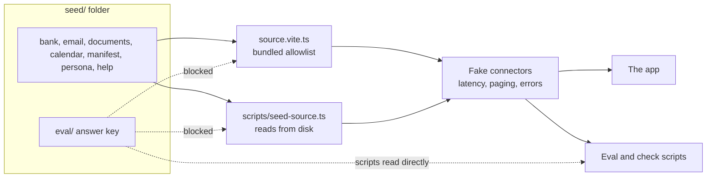

# Seed data guide

How Seal's fake household data was created, how the app reads it, why it behaves like real data, and how to add more.

Seal has no real bank, mailbox, document store or calendar connection. Its four connectors read a fictional household from [`seed/`](../../seed/). Everything else in the app, including the agent, the model calls and the interface, treats that data as if it came from real services.

## Contents

1. [The short version](#1-the-short-version)
2. [The household](#2-the-household)
3. [How the seed was created](#3-how-the-seed-was-created)
4. [What is in each source](#4-what-is-in-each-source)
5. [How the app reads the seed](#5-how-the-app-reads-the-seed)
6. [How it mimics real life](#6-how-it-mimics-real-life)
7. [The planted leaks and decoys](#7-the-planted-leaks-and-decoys)
8. [What the verifier guarantees](#8-what-the-verifier-guarantees)
9. [Regenerating the seed](#9-regenerating-the-seed)
10. [Adding or generating more](#10-adding-or-generating-more)
11. [What to run after a change](#11-what-to-run-after-a-change)
12. [Troubleshooting](#12-troubleshooting)

---

## 1. The short version

| Thing | Value |
| --- | --- |
| Household | Maya and Ben Whitlock, with Ollie (8) and Pia (5), renting in Brunswick, Melbourne |
| "Today" in the app | Thursday 19 November 2026, 9:30 am Melbourne time, always |
| Bank | 2 accounts, 134 transactions, 20 Aug to 18 Nov 2026 |
| Email | 78 messages, 28 Nov 2024 to 19 Nov 2026, 5 unread, 10 with attachments |
| Documents | 12 files: 11 PDFs and 1 meter photo |
| Calendar | 15 events on 3 calendars, 2 of them recurring |
| Help directory | 12 businesses, 25 contact channels, 14 help articles, 4 complaint bodies |
| Planted problems | 8 real leaks and 2 decoys that look like leaks but aren't |
| Integrity checks | 882, in `seed/verify.py` |

The most important files:

| File | Job |
| --- | --- |
| [`seed/generate.py`](../../seed/generate.py) | Builds almost the entire seed from one deterministic script |
| [`seed/verify.py`](../../seed/verify.py) | Proves the data adds up and the planted facts are still there |
| [`seed/eval/ground_truth.json`](../../seed/eval/ground_truth.json) | The answer key, for scoring only. **The running app must never read it** |
| [`src/connectors/`](../../src/connectors/) | The fake services that serve the seed to the app |

The help directory in `seed/help/` is the one part written by hand. `generate.py` doesn't touch it.

---

## 2. The household

The scenario is one specific job: a quiet monthly check for charges that are wrong or unwanted.

- **Maya Whitlock** is the primary user. She does most of the household admin and works as a designer at Cobalt Studio.
- **Ben Whitlock** is her partner. He works in operations at Tidewater Logistics. He often pays or books something and tells Maya by email, which is how several problems arise.
- **Ollie (8, Year 3)** and **Pia (5, Prep)** generate school payments and activity charges.
- They rent at 14 Albion Lane, Brunswick, for $2,420 a month.

[`seed/persona.json`](../../seed/persona.json) also stores the agent's standing preferences. Drafts use these directly:

| Preference | Value |
| --- | --- |
| Never act without approval | Send email, cancel a subscription, create a calendar event, move money |
| Tone | Friendly but firm, plain Australian English, no legalese |
| Sign-off | `Thanks, Maya` |
| Flag threshold | $10 a month |
| Send from | `maya.whitlock@mailbox.example` |

All people, addresses and businesses are made up. Email domains use the reserved `.example` domain. The one real brand name is Apple, because `APPLE.COM/BILL` is exactly the kind of unclear card descriptor the agent has to resolve. Its address in the seed is still fictional.

---

## 3. How the seed was created

### One script, in a fixed order

`generate.py` runs these steps in `main()`:

```text
build_bank()                    transactions, balances, ids, CSVs, accounts.json
build_docs()                    defines each document's content
render_docs()                   PDFs, the meter photo, text sidecars, index.json
build_emails()                  the whole mailbox, with links to documents
build_calendar()                events, including repeat rules
build_persona_and_connectors()  persona.json and connectors/manifest.json
build_ground_truth()            the answer key, using the real generated ids
write seed/README.md
```

The order matters. Emails link to documents, so documents must exist first. The answer key refers to real ids, so it is built last.

### The story comes first

Each leak was written as a small timeline before it became data. Skylink, for example:

1. On 14 Oct 2025, a welcome email and agreement promise $79 a month for 24 months.
2. On 9 Sep 2026, an unread "changes" email announces a new price.
3. The September bank charge is $79. October and November are $99.
4. The agreement proves the rise came 12 months too early.

The evidence is deliberately spread across bank rows, mail and a PDF, so no single source gives the answer. The agent has to connect them, as a person would.

### Noise surrounds the signal

Around the planted items, the generator adds ordinary life:

- groceries, fuel, coffee, a bakery, a pharmacy, hardware, restaurants and kids' books
- salaries, rent, transit, savings transfers, swimming lessons and council rates
- promotional email, school newsletters and bank notices

Noise amounts come from a function that refuses to produce a planted amount such as $17.99 or $385.00, so a random coffee can't accidentally look like evidence.

### Deterministic by design

Running the generator twice gives the same result:

- `rng = random.Random(20261119)` is the only source of randomness.
- "Now" is the constant `NOW`, never the computer's clock.
- Ids are assigned by rule, such as `JE-00024`, `msg_0024` and `doc_003`.

This matters because the app saves model answers keyed by the exact text of each request. Change one byte of evidence and that request has no saved answer.

### Existing PDFs and the photo are kept

Different versions of `reportlab` and Pillow draw slightly different bytes. So `render_docs()` follows two rules:

- **A PDF that already exists is kept.** Delete it if you want it drawn again.
- **The meter photo is always drawn, then thrown away if a copy already exists.** Drawing it consumes random numbers, and skipping that would change every random value generated after it, including those in later emails.

This means **Pillow is required every time you run the generator**, even when the photo already exists. `reportlab` is only needed when a PDF is missing.

### Stable ids

The seed grew over time, so existing ids are protected:

- A new email can be listed in `added_later` inside `build_emails()`. It then gets the next id, such as `msg_0076`, while the mailbox still reads in date order.
- New documents and events are added at the end of their lists, so they get the next `doc_` or `evt_` number.
- The warranty case (L8) was added this way, and has no bank rows at all, so no earlier transaction id moved.

---

## 4. What is in each source

### Bank: `seed/bank/`

| File | Contents |
| --- | --- |
| `accounts.json` | Institution, both accounts, opening and current balances |
| `joint-everyday.csv` | Joint Everyday, code `JE`, 81 rows |
| `maya-visa.csv` | Maya Visa credit card, code `MC`, 53 rows |

CSV columns:

```csv
TransactionId,Date,Description,Debit,Credit,Balance
JE-00024,2026-09-14,SKYLINK INTERNET P/L DIRECT DEBIT 0082914,79.00,,...
```

Conventions:

- Dates are `YYYY-MM-DD` in Melbourne time.
- `Debit` and `Credit` are positive numbers. Only one is filled in.
- A negative card balance means money is owed.
- The card is paid in full on the 12th. Each repayment on the card mirrors a `TRANSFER TO MAYA VISA` on the joint account.
- Descriptors are messy on purpose: legal suffixes, suburbs, reference numbers and platform names.

The connector turns each row into a `Transaction` with integer cents:

```ts
{
  id: "JE-00024",
  accountId: "acc_joint_everyday",
  date: "2026-09-14",
  description: "SKYLINK INTERNET P/L DIRECT DEBIT 0082914",
  amountCents: -7900,      // negative is money out
  balanceCents: ...
}
```

### Email: `seed/email/inbox.json`

The file holds Maya's mailbox, which also receives the shared `home@whitlock.example` address.

```json
{
  "id": "msg_0024",
  "threadId": "thr_msg_0024",
  "date": "2026-09-09T...+10:00",
  "from": { "name": "Skylink Internet", "address": "billing@skylink.example" },
  "to": [{ "name": "Whitlock household", "address": "home@whitlock.example" }],
  "subject": "Changes to your Skylink plan",
  "snippet": "First 140 characters of the body",
  "body": "Full text",
  "labels": ["INBOX"],
  "unread": true,
  "attachments": []
}
```

- Labels: `INBOX` (77), `PROMOTIONS` (15) and `SENT` (1).
- An attachment points to a real document through `documentId`.
- The five unread messages are all important: Skylink's price change, BrightPage's trial ending, Pia's reading streak pausing, the gym's annual fee, and Norvik's warranty ending. That mirrors how real leaks slip by.

### Documents: `seed/documents/`

```text
seed/documents/
  index.json
  _text/                    pre-extracted text, one .txt per file
  Home & Utilities/
    Appliances/             Larkspur receipt, Norvik warranty terms
    Council/                rates notice
    Energy/                 two Redgum bills, the meter photo
    Internet/               Skylink agreement
    Repairs/                Kestrel invoice
  Insurance/Car/            Wattle renewal, Banksia quote
  Memberships/              IronWorks agreement
  Phone/                    Kookaburra plan terms
```

`index.json` holds each file's id, path, folder, title, type, size, modified date, source and `textPath`.

The text sidecars imitate what a real document service gives you after indexing a PDF. **The meter photo is different.** It has a sidecar so people browsing the seed can see what it shows, but the app never reads it:

- the app's bundle excludes `*Photo*.txt`
- `readText()` returns `null` for a file marked `vision`
- the agent has to read the image with a vision model

**Folders carry meaning.** Retrieval treats files in one folder as related, which is how the meter photo joins the energy bills. A new file in an existing folder can become evidence for that folder's cases, and that changes their model requests. That's why the washer files have their own `Appliances` folder rather than sharing `Repairs`.

### Calendar: `seed/calendar/events.json`

Three calendars (Family, Maya, Ben) hold 15 events. Each has a title, start, end, all-day flag, notes, creator, creation date, location and an optional repeat rule:

```text
RRULE:FREQ=WEEKLY;BYDAY=SA;UNTIL=20261212T000000Z     Pia's swimming
RRULE:FREQ=WEEKLY;INTERVAL=2;BYDAY=SU                 Bins out
```

The connector expands repeating events into individual occurrences for the dates requested, like a real calendar API. It supports `DAILY`, `WEEKLY` and `MONTHLY`, with `INTERVAL`, `BYDAY`, `UNTIL` and `COUNT`. A sync reads 120 days back and 90 days ahead.

Reminders Seal adds are left out of later syncs. They are the app's own notes rather than household evidence, and leaving them out keeps model requests identical.

### Connection settings: `seed/connectors/manifest.json`

For each connector, the manifest describes access, scopes, page size, operations, last sync time and latency:

| Connector | Access | Page size | p50 | p95 |
| --- | --- | ---: | ---: | ---: |
| Bank | read-only | 50 | 260 ms | 900 ms |
| Email | read + draft | 25 | 180 ms | 650 ms |
| Documents | read-only | 20 | 120 ms | 400 ms |
| Calendar | read + create | all events | 150 ms | 500 ms |

It also defines three failure scenarios that are off by default:

| Scenario | Behaviour |
| --- | --- |
| `calendar_reauth` | Calendar calls fail with a 401, as if a token expired |
| `bank_rate_limit` | Every 4th transactions call returns a 429 asking to wait 3 seconds |
| `slow_documents` | Reading a document's text takes 4-6 seconds |

Press **⌘⇧D** in the app to switch them on.

### Help directory: `seed/help/`

A fix isn't always an email, so the agent needs to know how each business can be contacted. These three files are written by hand:

| File | Contents |
| --- | --- |
| `providers.json` | 12 businesses and 25 channels: 9 email, 7 call, 6 online, 3 chat |
| `articles.json` | 14 short help articles |
| `bodies.json` | Where to escalate: TIO, Energy and Water Ombudsman Victoria, Consumer Affairs Victoria (real), and one fictional bank disputes team |

A channel looks like this:

```json
{
  "id": "skylink_email",
  "kind": "email",
  "label": "Email billing",
  "address": "billing@skylink.example",
  "canDo": ["dispute_price", "refund"],
  "replyDays": 2,
  "keepsRecord": true,
  "acceptsFiles": true,
  "needs": ["Account number"],
  "articleId": "skylink-billing"
}
```

Contact safety is enforced by `verify.py`:

- Merchant phone numbers come from the Australian regulator's (ACMA's) range reserved for fiction, except two placeholder numbers already printed in the seed's documents (`1300 000 000` and `1300 000 111`).
- Chat and online links stay on the business's fictional domain.
- Real complaint bodies must link to their official site and record when they were checked.
- The help files never mention the household.

The app labels every merchant contact as a sample and never dials or opens it.

### Answer key: `seed/eval/ground_truth.json`

Contains the leaks, decoys, upcoming charges and scoring rules. Each leak lists its evidence ids, expected amounts, deadlines, expected action and what a draft should mention.

Only evaluation and check scripts in `scripts/` may read it. Section 5 covers how the app is prevented from reading it.

---

## 5. How the app reads the seed



A `SeedSource` has just two methods, `readText` and `readBytes`. The connectors don't know where the files came from:

- In the app, [`source.vite.ts`](../../src/connectors/source.vite.ts) bundles an explicit allowlist of files at build time.
- In Node scripts, [`seed-source.ts`](../../scripts/seed-source.ts) reads them from disk.

**The answer key is protected in three layers:**

1. The bundle allowlist never lists `seed/eval/`.
2. `assertAllowedSeedPath()` throws if any connector path points into it, in both the app and scripts.
3. Scripts that score results read it directly, without going through a connector. `scripts/connectors-check.ts` proves that the connector path refuses it.

---

## 6. How it mimics real life

| Real-world behaviour | How the seed reproduces it |
| --- | --- |
| Bank text is messy | `SKYLINK INTERNET P/L DIRECT DEBIT 0082914`, `APPLE.COM/BILL SYDNEY AU` |
| A platform hides the seller | The card only says Apple. StreamBox appears only in Apple's receipt emails |
| One business, several descriptions | Kestrel appears as a card merchant and as a bank transfer with an invoice number |
| Family members act separately | Ben pays the plumber again, and sets up a service Maya already pays for |
| Important mail goes unread | Five important emails are unread among promotions and newsletters |
| Evidence is scattered | Each leak spans at least two sources, usually more |
| Some evidence isn't text | The meter reading exists only in a photo, with a red tenths digit that's easy to misread |
| Statements have a limited history | The bank starts on 20 Aug, while mail goes back to 2024. Two StreamBox charges are visible only through email |
| A legitimate change looks suspicious | The mobile plan's 4% rise is allowed by its contract |
| A true coincidence looks like an error | Two identical school payments on one day are for different children |
| Deadlines are easy to miss | The gym's 14-day notice period passed five days before "today" |
| Problems occur before any charge | Wattle's renewal and the washer repair have no bank rows yet |
| APIs are paged | Each connector returns pages with a cursor |
| Networks are uneven | Delays follow a skewed curve fitted to each connector's p50 and p95 |
| Services fail | Expired tokens, rate limits and slow reads can be switched on |
| Sending is a privilege | The email connector has no send operation. It can only save drafts |

The delay model uses a log-normal curve, because most real calls cluster near the median with a long tail. It is clamped between `0.3 x p50` and `1.5 x p95`. Scripts set `latencyScale: 0` so checks run instantly.

---

## 7. The planted leaks and decoys

### Leaks

| ID | Business | Type | What happened | Key figures | Next date |
| --- | --- | --- | --- | --- | --- |
| L1 | Skylink | Price rise against contract | Rose from $79 to $99 after 12 months of a promised 24 | $40 overcharged, $240 at stake | 14 Dec |
| L2 | StreamBox | Duplicate subscription | Paid directly (Ben) and through Apple (Maya) | 5 duplicates, $89.95, $17.99 a month | Cancel by 20 Nov |
| L3 | IronWorks Fitness | Renewal trap | $89 annual fee, and the 14-day notice date has passed | Last visit 3 Sep | Fee on 28 Nov |
| L4 | BrightPage Kids | Trial converted | Free trial became a paid plan nobody uses | $44.97 paid, $14.99 a month | 18 Dec |
| L5 | Kestrel Plumbing | Paid twice | One invoice paid by card and by bank transfer | $385.00 refund due | None |
| L6 | Wattle Insurance | Renewal price creep | Premium up 31%, with a cheaper like-for-like quote | $1,485.54 against $1,109.00, saving $376.54 | Quote ends 4 Dec |
| L7 | Redgum Energy | Billing error | Estimated reading far above the photographed meter | About $175 overbilled (±$15) | None |
| L8 | Norvik and Spinwell | Warranty claim | A paid repair is booked for a washer still under warranty | $264.00 repair | Cancel by 25 Nov, 10 am |

### Where each leak's evidence lives

| ID | Transactions | Emails | Documents | Events |
| --- | --- | --- | --- | --- |
| L1 | `JE-00024`, `JE-00051`, `JE-00077` | `msg_0002`, `0010`, `0024`, `0027`, `0047`, `0072` | `doc_001` | |
| L2 | `JE-00013`, `00041`, `00065`, `MC-00002`, `00024`, `00038` | `msg_0004`, `0005`, `0007`, `0012`, `0018`, `0032`, `0041`, `0052`, `0062` | | |
| L3 | `JE-00016`, `00043`, `00066` | `msg_0001`, `0048`, `0056`, `0061` | `doc_008` | `evt_004` |
| L4 | `MC-00021`, `00034`, `00052` | `msg_0026`, `0029`, `0030`, `0039`, `0051`, `0074` | | |
| L5 | `MC-00027`, `JE-00039` | `msg_0034`, `0035`, `0040`, `0042` | `doc_009` | |
| L6 | | `msg_0063`, `0066`, `0067` | `doc_006`, `doc_007` | `evt_006` |
| L7 | `JE-00072` | `msg_0006`, `0055`, `0058`, `0069` | `doc_002`, `doc_003`, `doc_004` | |
| L8 | | `msg_0076`, `0077`, `0078` | `doc_011`, `doc_012` | `evt_015` |

### What each leak is designed to test

- **L1** needs a contract term to be read and compared with dates. A model that only sees "the price went up" can't tell it from a legal rise.
- **L2** needs an opaque descriptor resolved through email.
- **L3** needs date arithmetic, and honesty: the notice date was missed, so the draft asks for goodwill rather than claiming a right.
- **L4** combines a trial, charges and evidence of non-use.
- **L5** needs the same invoice recognised across two payment methods.
- **L6** has no bank rows, and the quote must be checked as genuinely comparable: the same $14,500 agreed value and $650 excess.
- **L7** needs vision, plus arithmetic that code must do.
- **L8** needs two businesses linked by a serial number (`NVK-204417`), with no charge yet.

### Decoys

These must **not** be flagged:

| ID | Looks like | Why it's fine |
| --- | --- | --- |
| D1 | Kookaburra Mobile rose from $55.00 to $57.20 | The plan allows CPI indexation, notice was sent, and 55.00 x 1.04 = 57.20 |
| D2 | Two $38.00 SchoolPay charges on one day | Different children, references (`OH-Y3-0908`, `PI-PR-0908`) and excursions |

---

## 8. What the verifier guarantees

```bash
python3 seed/verify.py
```

A healthy seed prints `882 checks passed, 0 failed`. It exits non-zero on any failure.

| Area | Examples of what it proves |
| --- | --- |
| Bank | Every running balance, unique ids, dates in the window, sort order, closing balances, card repayments mirrored |
| Planted bank facts | Skylink charged 79, 99, 99. StreamBox, gym and BrightPage counts and amounts. Kestrel paid once per account |
| Noise | No random transaction collides with a planted amount |
| Document arithmetic | Energy bill sums, daily averages, meter differences, insurance maths, the notice deadline |
| Text sidecars | Every indexed file and sidecar exists, and key facts appear in them |
| Email | Unique ids, date order, nothing after "now", every attachment points to a real document |
| Cross-source facts | Skylink invoices match the bank. All Apple receipts name StreamBox. Both Kestrel receipts exist |
| Answer key | Every evidence id exists. There are exactly 8 leaks and 2 decoys |
| Help directory | Known channel types, real article links, safe phones and links, no mention of the household |
| Washer case | Its ids, its serial number, no bank rows, and its warranty dates |

Some counts are hard-coded on purpose. Adding a ninth leak fails verification until you update `verify.py`.

---

## 9. Regenerating the seed

Regenerating is safe and should produce **no file changes**. Do it when you've changed `generate.py`.

### Set up Python

```bash
python3 -m venv .venv-seed
```

```bash
.venv-seed/bin/pip install pillow reportlab
```

### Run it

```bash
.venv-seed/bin/python seed/generate.py
```

Expected output:

```text
txns: 134 | docs: 12 | emails: 78 | events: 15
```

Then verify, and check what changed:

```bash
python3 seed/verify.py
```

```bash
git status --short seed
```

With an unchanged generator, `git status` shows nothing. If it lists files, read the diff before going further.

Delete `.venv-seed` when you're finished, so it isn't committed by accident.

---

## 10. Adding or generating more

### Golden rules

1. **Change `generate.py`, not the generated files.** A hand edit is overwritten by the next run. The exception is `seed/help/`, which is edited directly.
2. **Don't use `rng` before existing `rng` calls.** Extra random calls change every later random value. If new data needs randomness, give it its own generator, such as `random.Random(42)`.
3. **Don't move existing ids** unless you're prepared to re-run the live models.
4. **Don't let new noise look like evidence.** Add any new planted amount to `SPECIAL`.
5. **Keep everything fictional.** Use `.example` domains and phone numbers reserved for fiction.
6. **Keep "today" in step.** `NOW` in `generate.py` must match `FIXED_NOW` in `src/lib/clock.ts`.

### Add an email

Add a call inside `build_emails()`:

```python
email("northwind_notice", AT(2026, 11, 12, 9, 15), ("Northwind", "hello@northwind.example"), [HOME],
      "Your plan is changing", """
      Hi Maya,

      Your plan changes on 1 December.

      The Northwind team
      """, unread=True)
```

To keep every existing id stable, add its tag to `added_later`:

```python
added_later = {"ben_washer", "spinwell_booking", "norvik_warranty_notice", "northwind_notice"}
```

To attach a document, pass `att=["document_tag"]`. The document must already be defined.

### Add a document

Add a `doc(...)` call at the **end** of the document list in `build_docs()`:

```python
doc("northwind_terms", "Home & Utilities/Northwind", "Northwind-Plan-Terms.pdf",
    "Plan terms", "Northwind", "#336699", [
        ("h", "Your plan"),
        ("kv", [("Plan", "Standard"), ("Monthly price", "$30.00")]),
        ("p", "Prices are fixed for 12 months."),
        ("table", [["Item", "Amount"], ["Monthly fee", "$30.00"]]),
        ("note", "Keep this document for your records."),
    ], D(2026, 10, 1), "Attachment to email 'Your plan'")
```

Block types are `h` (heading), `p` (paragraph), `kv` (key and value rows), `table` and `note`. The generator creates the PDF, the text sidecar and the index entry. Use **a new folder** unless the file really belongs with what's already there, because retrieval links files by folder.

### Add a calendar event

Add an `ev(...)` call at the **end** of `build_calendar()`:

```python
ev("northwind_due", "Northwind plan changes", "2026-12-01", all_day=True, creator="Maya",
   created=iso(AT(2026, 11, 12, 10)))
```

For a repeating event, pass `recurrence="RRULE:FREQ=MONTHLY;BYDAY=MO"`.

### Add a transaction

```python
txn(JE, D(2026, 10, 20), "NORTHWIND PTY LTD 44182", -30.00, "northwind_oct")
```

**This is the most disruptive change.** Ids are assigned by date within each account, so inserting a row renumbers every later row in that account and changes its running balance. Those ids and rows appear in model requests, so most saved answers for that account stop matching. Plan on a full live run afterwards.

If a new case doesn't need a charge yet, avoid bank rows entirely, as L6 and L8 do.

### Add a business's contact details

Edit `seed/help/providers.json` directly. Each channel needs a known `kind`, valid `canDo` values and an existing `articleId`:

- `email` needs an `address` that appears in the mailbox
- `call` needs a `phone` from the reserved fiction range
- `chat` and `online` need an `https://` link on the provider's own `domain`
- `online` needs at least two `steps`

### Add a new leak

1. Write the story as a timeline, with at least two sources of evidence.
2. Add its emails, documents, events and any charges, following the rules above.
3. Add a contact entry in `seed/help/providers.json`, and an article in `articles.json`.
4. Add the leak to `build_ground_truth()`, using the helpers `T()`, `Ts()`, `E()`, `Es()`, `Dc()` and `C()`, so ids never have to be typed by hand.
5. Update `verify.py`: the expected leak count, plus checks for the new facts.
6. Update `scripts/eval.ts`: what the draft must mention, and the expected best route.
7. Confirm the detectors raise it with `node scripts/detectors-check.ts`.
8. If it's a new kind of problem, the agent also needs detector, verification and drafting logic. See the [architecture guide](../architecture/architecture.md#16-recipes).
9. Run the model pipeline live and save the new answers.

### Add a new decoy

A good decoy has a real, documented reason to be fine, and looks exactly like a leak to a simple rule. Add its data, add it to `decoys` in `build_ground_truth()`, and update the count in `verify.py`. Confirm the judge clears it in several live runs, because this is where a model is most likely to raise a false alarm.

### Generate more noise

Noise is added in the "everyday noise" block of `build_bank()` and near the end of `build_emails()`. To add more without moving what's already there:

- use a separate `random.Random(...)`
- use `noise_amount()` or check against `SPECIAL`
- expect transaction ids to move if you add bank rows

### Build a different household

The connectors and agent don't contain household names, so a new household mostly means a new generator:

1. Copy `seed/generate.py`, and replace the people, address, merchants and timelines.
2. Keep the output file shapes exactly the same.
3. Update the fixed date in `src/lib/clock.ts` if "today" changes.
4. Rewrite `verify.py`'s planted-fact checks and `scripts/eval.ts`'s expectations.
5. Run everything live, because no saved answers will apply.

The detectors were written and tested against this household, so expect to find rules that need broadening.

---

## 11. What to run after a change

Run these in order, stopping at the first failure:

```bash
python3 seed/verify.py
```

```bash
node scripts/connectors-check.ts
```

```bash
node scripts/detectors-check.ts
```

```bash
node scripts/retrieval-check.ts
```

If you have saved model answers locally, check they still match:

```bash
node scripts/saved-answers-check.ts
```

If that reports missing answers, the change reached a model request. Re-run the models live, which needs `BC_BASE_URL` and `BC_API_KEY` in `.env`:

```bash
node --env-file=.env scripts/eval.ts --live
```

Back up `.cache/llm` first, because `--live` overwrites saved answers.

---

## 12. Troubleshooting

| Problem | Cause and fix |
| --- | --- |
| `ModuleNotFoundError: No module named 'PIL'` | The photo is always drawn. Install Pillow (section 9) |
| `No module named 'reportlab'` | A PDF is missing and has to be drawn. Install `reportlab`, or restore the file |
| `git status` shows PDFs or the photo changed | They were deleted and redrawn with a different library version. Restore them with `git checkout -- seed/documents` |
| Lots of bank ids changed | A row was inserted, or `rng` was called earlier than before |
| Emails changed wording | The random sequence moved. Look for a new `rng` call |
| `verify.py` fails on "expected 8 leaks" | Update the count after adding or removing a leak |
| `Seed file not bundled` in the app | The file isn't in the allowlist in `src/connectors/source.vite.ts` |
| A finding shows "Couldn't decide" on saved answers | The evidence changed, so that request has no saved answer. Run it live |
| A new file changed an unrelated finding | It was added to a folder that case already uses. Give it its own folder |
| New event doesn't show up | It's outside the 120-days-back, 90-days-ahead sync window |
